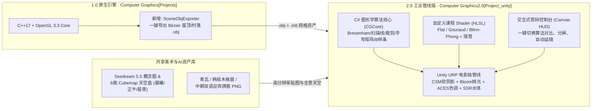

# 延边朝鲜族民俗村·乡村振兴 2.0 升级方案
## `YanbianVillage_v2_Unity_Plan.md` —— 原生 OpenGL 3.3 与 Unity URP 双擎联动架构设计

> [!IMPORTANT]
> **2.0 版本核心定位**
> - **仓库独立目录**：`Computer Graphics2.0[Project_unity]`（与 1.0 原生引擎 `Computer Graphics[Projects]` 并列存于同一 Git 仓库，形成**“底层光栅算法手写引擎 (v1.0) + 工业级渲染管线作品集展示引擎 (v2.0)”**双版本对照）。
> - **零手工建模负担**：无需使用 Blender / Maya 手工建模。我们通过 **“C++ 端自动化 OBJ/MTL 几何资产导出器 + Unity C# 参数化曲面实时生成器”** 双通道，将 1.0 中的双三次 Bézier $C^1$ 朝鲜族反宇飞檐、四柱迎宾牌楼、秋千/跳板/风车层级模型及 Seedream 5.5 贴图一键桥接至 Unity。
> - **100% 覆盖课程评分点**：在享受 Unity URP 电影级后处理（Bloom 辉光、ACES 色调映射、级联阴影 CSM、体积雾、水体屏幕空间反射）的同时，所有《计算机图形学》课程要求的手写算法（2D 光栅化与裁剪、手写矩阵变换、Bézier/B 样条曲面曲线、Flat/Gouraud/Phong 自定义 Shader、平面投影阴影、视锥剔除）均在 `Assets/Scripts/CGCore/` 与 `Assets/Shaders/` 中保留独立可审计源码。

---

## 一、您需要在本机下载与准备的软件清单

您目前本机已具备完整的 C++17 (`MinGW-w64 g++ 16.1.0`)、Python 3 与 Git 环境。为了运行与构建 **2.0 Unity 版本**，您只需在本机安装 **Unity Hub 与 Unity Editor LTS**：

### 1. 必装软件（仅此一项）
1. **Unity Hub（官方启动与版本管理器，约 120 MB）**
   - 官方下载地址：https://unity.com/download （若使用中国区网络可访问 https://unity.cn/releases ）
   - 或者直接让我通过终端为您执行 `winget install Unity.UnityHub` 自动下载安装。
2. **Unity Editor 版本选择（在 Unity Hub 内勾选安装，约 4.5 ~ 6 GB）**
   - **推荐版本**：**Unity 2022.3 LTS**（如 `2022.3.x f1`）或 **Unity 6 LTS (`6000.0.x f1`)**。
   - **安装模块（Modules）勾选建议**：
     - 必选：`Windows Build Support (Mono)`（用于一键打包 `.exe` 独立演示程序）
     - 可选：`Microsoft Visual Studio Community` 或直接使用您现有的编辑器（我们所有 C# 脚本与 HLSL Shader 均可由我直接编写并由 Unity 自动编译，您无需手动配 IDE）。

> [!TIP]
> **安装耗时与磁盘空间建议**
> - 建议将 Unity Editor 安装在空间充裕的 `D:\Unity\` 目录下（预留约 10 GB 空间）。
> - **在我为您生成全套 C# 脚本、HLSL 着色器与导出资产期间，您可以同步在后台安装 Unity Hub**。哪怕还没装好 Unity，我也可以先把 `Computer Graphics2.0[Project_unity]` 的完整 Unity 工程骨架、`ProjectSettings`、`Packages/manifest.json`、C# 源码、自定义 Shader 以及从 1.0 导出的 `.obj` 模型与 Seedream 贴图全部生成就绪！

---

## 二、为什么 2.0 采用“C++ 原生导出 + Unity URP 升级”架构？



### 1.0 与 2.0 视觉与工程效果对比

| 维度 | 1.0 原生 OpenGL 3.3 (`Computer Graphics[Projects]`) | 2.0 Unity 升级版 (`Computer Graphics2.0[Project_unity]`) |
| :--- | :--- | :--- |
| **课程底层加分项** | 纯 C++17 从零管理 VAO/VBO、状态机与 GLSL 管线 | 完整保留 C# 版手写图形学算法类 + 自定义 HLSL 顶点/片元着色器 |
| **阴影系统** | 地面 `y=0.015` 齐次平面投影矩阵硬阴影 + 模板缓冲防重影 | **保留平面投影阴影演示开关** + **Unity URP 4 级联阴影贴图 (CSM) 全局软阴影**（建筑与树木自身可互相投射柔和阴影） |
| **光照与夜景氛围** | Blinn-Phong 1 平行光 + 6 点光源线性混合 | **HDR 多光源 + Post-Processing Bloom 辉光**（星夜模式下韩纸木格窗与迎宾灯笼散发温暖电影感柔光）+ **ACES Filmic 色调映射** |
| **布尔哈通河水面** | 正弦顶点波 + Cubemap 菲涅尔反射 | **Gerstner 叠加波 + 深度岸边消波泡沫 + 焦散 + 天空盒/倒影混合** |
| **稻田与植被** | 2,000 株交叉十字面片 `glDrawElementsInstanced` | **`Graphics.DrawMeshInstanced` 10,000+ 株金秋风吹麦浪** + 视锥剔除实时统计面板 |
| **交互与答辩展示** | 快捷键切换 + 右上角 2D 沙盘贴图叠加 | **现代化毛玻璃答辩 UI 面板**：可视化调节 Bézier 控制点曲率、实时拖动裁剪窗口、一键三态天光平滑过渡与电影运镜 |

---

## 三、`Computer Graphics2.0[Project_unity]` 工程目录结构设计

新项目在 Git 仓库根目录下独立为 `Computer Graphics2.0[Project_unity]/`，遵循标准 Unity 工程规范，打开 Unity Hub 点击 **`Add -> Add project from disk`** 即可直接加载运行：

```text
Computer Graphics2.0[Project_unity]/
├── YanbianVillage_v2_Unity_Plan.md       # 本设计方案文档
├── README.md                             # 2.0 工程说明、运行指南与算法对照表
├── ProjectSettings/                      # Unity 工程配置 (颜色空间 Linear、URP 管线配置)
├── Packages/
│   └── manifest.json                     # 依赖包清单 (URP, PostProcessing, UI)
└── Assets/
    ├── Scenes/
    │   └── YanbianVillage_Main.unity     # 主场景（支持代码全自动一键构建/重建场景）
    ├── Meshes_Exported/                  # 由 1.0 C++ 引擎精确导出的 .obj 网格资产
    │   ├── KoreanHouse_BezierRoof.obj    # 6 片双三次 Bézier C1 拼接屋顶与白墙民居
    │   ├── WelcomeGate.obj               # 四柱双坡迎宾牌楼
    │   └── VillageProps.obj              # 石井、酱缸台、围墙与石桥
    ├── Textures/
    │   ├── Skybox/{dawn,noon,night}/     # Seedream 5.5 6面体天空盒贴图与全景图
    │   ├── Architecture/                 # 青瓦、韩纸窗、中朝双语牌匾、导览牌贴图
    │   └── ConceptArt/                   # 图2/图3 晨曦与星夜概念设计图（内置画廊查看）
    ├── Shaders/
    │   ├── CG_UberLit.shader             # 课程核心 HLSL：支持 Flat/Gouraud/Blinn-Phong 三态切换与瑞雪覆盖
    │   ├── CG_PlanarShadow.shader        # 课程核心 HLSL：齐次平面投影矩阵 (M_shadow) 与 Stencil 防重影
    │   ├── CG_RiverWater.shader          # 布尔哈通河水体 Shader（Gerstner 波 + 菲涅尔反射 + 岸边泡沫）
    │   └── CG_InstancedRice.shader       # GPU Instancing 稻穗风浪顶点动画 Shader
    ├── Scripts/
    │   ├── CGCore/                       # 【图形学手写算法核心层 —— 供答辩代码走查】
    │   │   ├── MathUtil4x4.cs            # 手写 TRS、LookAt、Perspective、Ortho 矩阵及与 Unity Matrix4x4 误差校验
    │   │   ├── MatrixStack.cs            # 手写矩阵堆栈 (Push / Pop / MultMatrix)
    │   │   ├── Raster2DSandbox.cs        # CPU 像素缓冲：中点 Bresenham 画线/圆、扫描线填充、Cohen-Sutherland 裁剪
    │   │   ├── BezierPatchGenerator.cs   # 双三次 Bézier 曲面 (16 控制点 + C1 连续 + 解析偏导法线) 实时生成 Mesh
    │   │   ├── BSplineTourPath.cs        # 三次均匀 B 样条闭环曲线求值与切线朝向计算
    │   │   └── FrustumCuller.cs          # Gribb-Hartmann 6 平面提取与 AABB 视锥剔除器
    │   ├── Scene/                        # 【场景构建与层级动画层】
    │   │   ├── YanbianSceneBootstrapper.cs # 运行时/编辑器一键自动组装完整延边民俗村场景（无需手动摆物体）
    │   │   ├── HierarchyAnimator.cs      # 基于手写 MatrixStack 驱动风车、秋千、跳板、追日光伏板、导览车
    │   │   └── RiceFieldInstancer.cs     # 基于 FrustumCuller + Graphics.DrawMeshInstanced 的万株金秋稻浪
    │   ├── FX/                           # 【光影、大气与粒子特效层】
    │   │   ├── TimeOfDayController.cs    # 晨曦/正午/星夜三态天光、Seedream 天空盒插值、6 盏庭院暖光灯与 Bloom 控制
    │   │   └── ChimneyAndSnowParticles.cs# 独立砖砌烟囱炊烟与初冬瑞雪粒子系统控制
    │   └── UI/                           # 【答辩交互 HUD 与画中画对比台】
    │       └── DefenseHudController.cs   # 屏幕顶栏状态、右侧参数面板、2D 光栅沙盘放大镜、概念图对比画廊
    └── Editor/
        └── AutoBuildVillageEditor.cs     # Unity 菜单栏一键菜单：`Yanbian CG 2.0 -> One-Click Build Scene & Materials`
```

---

## 四、核心亮点：如何让 Unity 工程“打开即运行，无需手工拖拽”？

传统 Unity 项目最痛点的是需要在编辑器里手工拖拽几百个 Prefab、材质球和灯光，而且 `.unity` 场景二进制文件在 Git 中极易冲突。
在 **2.0 方案**中，我们采用 **“Editor 一键生成脚本 (`AutoBuildVillageEditor.cs`) + 运行时自举器 (`YanbianSceneBootstrapper.cs`)”** 双保险机制：

1. **C++ 资产桥接导出器 (`tools/export_to_unity.cpp`)**：
   - 直接调用 1.0 引擎的 `KoreanHouse`、`BezierRoof`、`Terrain`、`MeshBuilder`，将所有程序化生成的精致网格导出为标准 `.obj` 文件存入 `Computer Graphics2.0[Project_unity]/Assets/Meshes_Exported/`。
2. **Unity 菜单栏一键构建 (`Yanbian CG 2.0 -> Build Complete Village Scene`)**：
   - 您用 Unity 打开 `Computer Graphics2.0[Project_unity]` 后，只需点击顶部菜单栏 **`Yanbian CG 2.0 -> 1. 一键生成延边民俗村完整场景`**（或者直接按 `Play` 键），脚本会自动：
     - 加载 `Assets/Textures/Skybox/` 下由 Seedream 5.5 切片生成的晨曦、正午、星夜 Cubemap；
     - 创建并绑定自定义 HLSL 课程着色器材质（青瓦、白墙、韩纸木格窗、中朝双语迎宾牌匾）；
     - 实例化 6 栋朝鲜族合院民居（含实时可调曲率的双三次 Bézier 飞檐）、村口四柱迎宾牌楼、布尔哈通河湾、万株金秋稻田、3 座风力发电机、光伏阵列、秋千、跳板、水井、酱缸台与巡游电瓶车；
     - 自动配置方向光、6 盏星夜庭院暖光点光源、Post-Processing 辉光以及交互式答辩 UI 面板！

---

## 五、分阶段实施工作包规划（WP-U1 ~ WP-U5）

当您审计通过本方案后，我将按以下 5 个工作包为您自动生成全部代码与资产，并提交至 Git 仓库的 `Computer Graphics2.0[Project_unity]` 目录：

| 工作包 | 模块名称 | 核心交付内容 | 对应图形学考点 |
| :--- | :--- | :--- | :--- |
| **WP-U1** | **工程骨架与 C++->Unity 资产桥接** | 初始化 Unity 工程配置 (`Packages`、`ProjectSettings`)；编写并运行导出工具生成 `.obj` 建筑资产；迁移 Seedream 5.5 天空盒与全部 PNG 贴图至 `Assets/Textures/` | 网格拓扑、UV 映射、Cubemap 环境贴图 |
| **WP-U2** | **C# 图形学核心算法库 (`CGCore`)** | 实现 `MathUtil4x4.cs`、`MatrixStack.cs`、`Raster2DSandbox.cs`（Bresenham/扫描线/Cohen-Sutherland）、`BezierPatchGenerator.cs`（实时调节飞檐翘角曲率）、`BSplineTourPath.cs`、`FrustumCuller.cs` | 二维光栅化与裁剪、手写矩阵变换、参数曲面与曲线、视锥剔除 |
| **WP-U3** | **HLSL 课程着色器与水体/阴影系统** | 编写 `CG_UberLit.shader`（支持 Flat/Gouraud/Blinn-Phong 实时切换与初冬瑞雪法线混合）、`CG_PlanarShadow.shader`（平面投影阴影矩阵 + CSM 切换对比）、`CG_RiverWater.shader` | 三种明暗处理模型、GLSL/HLSL 可编程管线、平面投影阴影、菲涅尔反射 |
| **WP-U4** | **场景自举器、层级动画与三态天光** | 实现 `YanbianSceneBootstrapper.cs`、`HierarchyAnimator.cs`（风车/秋千/跳板/追日光伏板/导览车）、`RiceFieldInstancer.cs`、`TimeOfDayController.cs`（晨曦/正午/星夜 + 6 盏暖光灯 + 炊烟瑞雪粒子） | 多层级树状建模动画、GPU 实例化、多光源融合、粒子系统 |
| **WP-U5** | **交互式答辩控制台 HUD 与文档归档** | 实现 `DefenseHudController.cs`（可视化按钮切换所有考点、实时显示 FPS/DrawCall/剔除率、内置 Seedream 概念图对比画廊）、Editor 一键构建菜单及 `README.md` | 综合交互设计、工程规范与答辩演示闭环 |

---

## 六、请您审计确认

1. **目录与分支结构**：我已在本地仓库与桌面创建了本方案 [`YanbianVillage_v2_Unity_Plan.md`](file:///d:/Antigravity_work/YanbianVillage/Computer%20Graphics2.0%5BProject_unity%5D/YanbianVillage_v2_Unity_Plan.md)，并在 Git 仓库中独立建立了 [`Computer Graphics2.0[Project_unity]`](file:///d:/Antigravity_work/YanbianVillage/Computer%20Graphics2.0%5BProject_unity%5D) 目录。
2. **是否需要我帮您用命令行自动安装 Unity Hub**：如果您希望省去浏览器下载步骤，只需告诉我一声，我可以直接在终端运行 `winget install Unity.UnityHub` 帮您把 Unity Hub 装好。
3. **审计通过后即可开工**：请审阅上述 **WP-U1 ~ WP-U5** 方案，若无异议或有增改意见请告诉我，我立即开始为您生成 `Computer Graphics2.0[Project_unity]` 的全套代码与资产！
