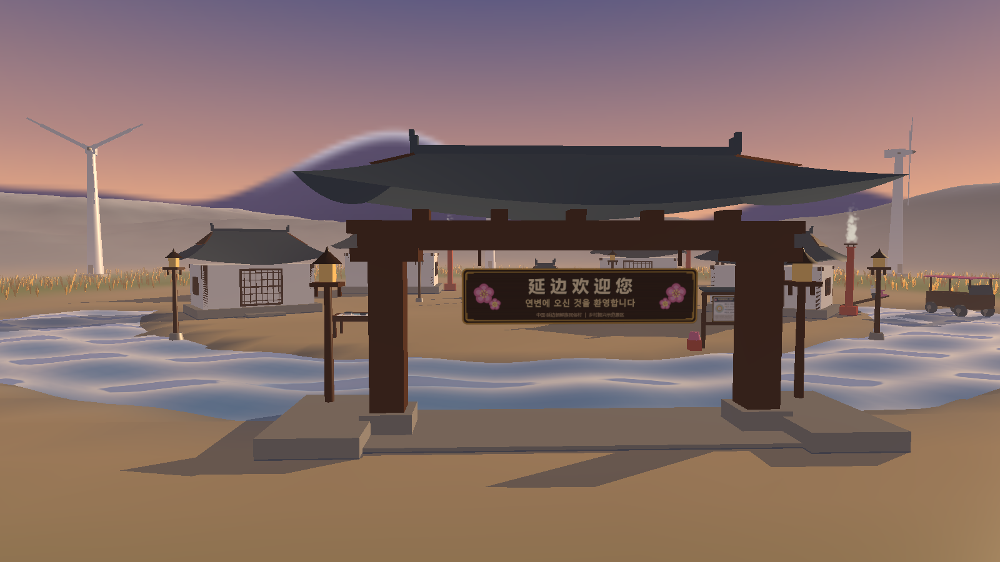
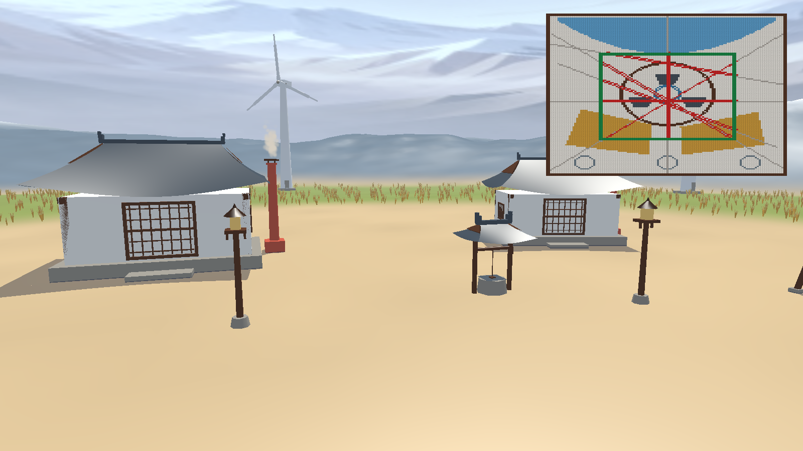
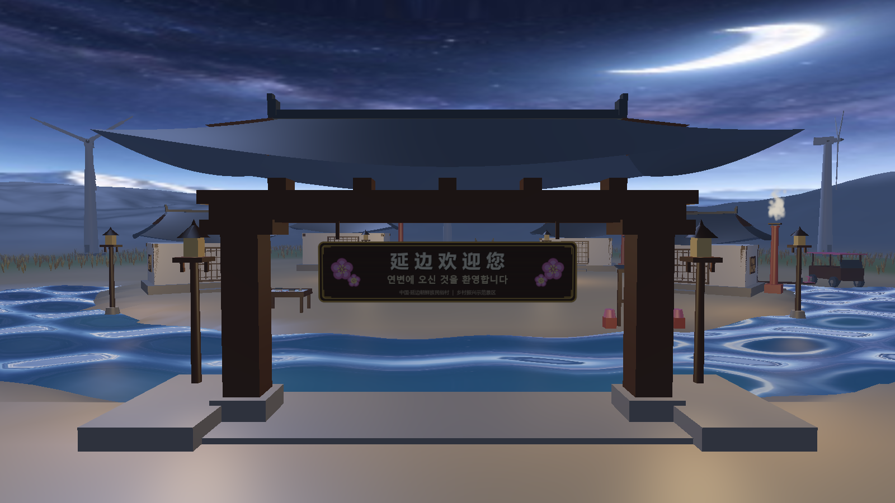
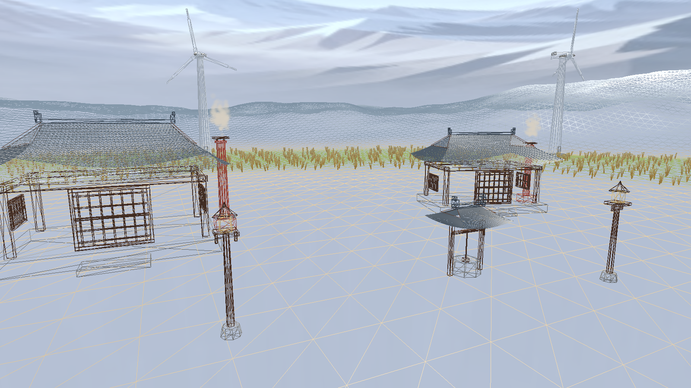
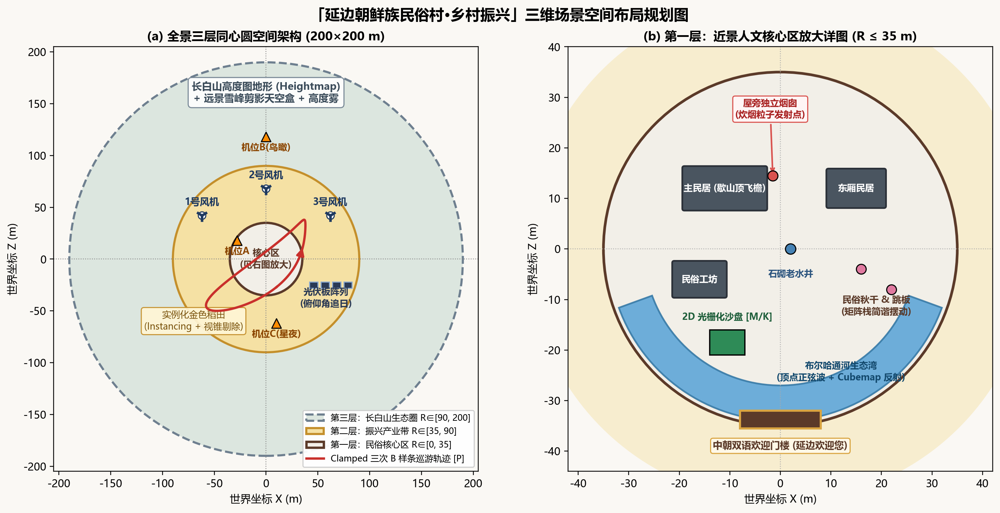
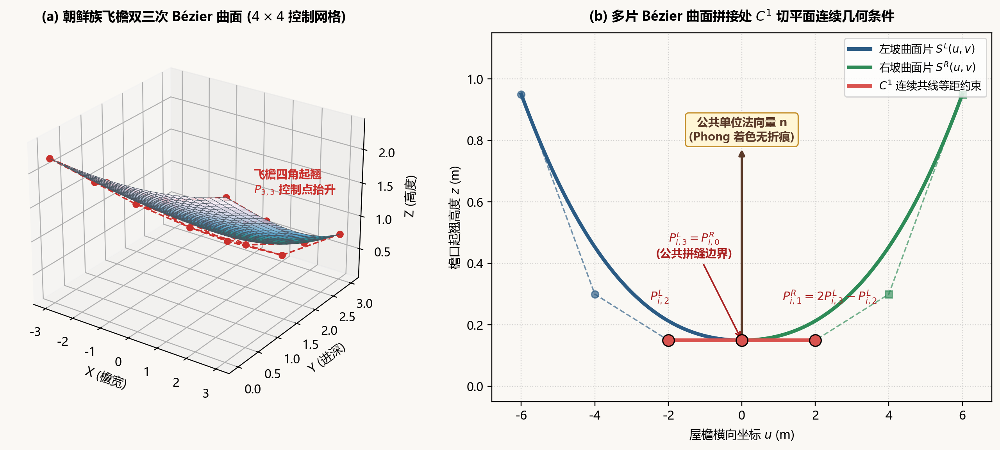

# 延边朝鲜族民俗村·乡村振兴 — 三维数字场景设计与实现 (v1.0 & v2.0 双擎版)

[](https://isocpp.org/)
[](https://www.opengl.org/)
[](https://unity.com/)
[]()
[]()

> **《计算机图形学》课程设计双版本对照仓库（v1.0 原生 OpenGL + v2.0 Unity 6 双擎联动）**  
> 本仓库同时包含 **1.0 纯手写底层渲染引擎** 与 **2.0 Unity 电影级管线升级工程**，形成“底层图形学算法推导与工业级实时渲染管线”的完整闭环：
>
> | 版本目录 | 技术栈 | 核心定位与亮点 | 文档入口 |
> | :--- | :--- | :--- | :--- |
> | **[`Computer Graphics[Projects]`](./Computer%20Graphics[Projects])** *(及仓库根目录)* | **C++17 + OpenGL 3.3 Core + GLSL** | 从零手写 VAO/VBO、Uber-Shader 框架、Bresenham/扫描线/Cohen-Sutherland 2D 沙盘、6片双三次 Bézier $C^1$ 飞檐、B 样条、平面投影阴影与 Seedream 5.5 全景天空盒 | [本页下方文档](#一-实机渲染与设计预览) / [`Course_Report.md`](docs/Course_Report.md) |
> | **[`Computer Graphics2.0[Project_unity]`](./Computer%20Graphics2.0[Project_unity])** | **Unity 6 (`6000.6.8f1`) + C# `CGCore` + 自定义 HLSL** | 100% 保留手写图形学算法类与自定义 HLSL 着色器，新增 C++ $\to$ `.obj` 自动化资产桥接、CSM 级联软阴影 vs 手写平面投影阴影实时切换、HDR Bloom + ACES 色调映射、飞檐曲率实时滑块调参控制台 | [2.0 工程 README](./Computer%20Graphics2.0[Project_unity]/README.md) / [2.0 架构方案](./Computer%20Graphics2.0[Project_unity]/YanbianVillage_v2_Unity_Plan.md) |

---

## 一、 实机渲染与设计预览

### 1. OpenGL 3.3 实机运行截图
| 金秋晨曦主视觉（机位 A） | 正午平面投影阴影 + 2D 光栅化与裁剪沙盘 |
| :---: | :---: |
|  |  |
| **星夜灯火多点光源照明（机位 C）** | **纯线框网格模式（`G` 键）** |
|  |  |

### 2. 三层同心圆空间规划与算法示意图
| 三层同心圆空间架构与近景放大图 | 双三次 Bézier 飞檐 $C^1$ 连续拼接原理 |
| :---: | :---: |
|  |  |

---

## 二、 核心图形学特性与教材章节映射

本项目不依赖任何外部 3D 模型文件，**全部建筑、曲面、地形、天空盒与沙盘纹理均由纯手写数学公式与图形学算法程序化生成**：

| 课程章节 | 工程实现模块 | 核心手写算法与图形学亮点 |
| :--- | :--- | :--- |
| **1. 基本图元光栅化** | [`src/ui/Raster2DBoard.cpp`](src/ui/Raster2DBoard.cpp) | 纯手写全八分象限整数 **Bresenham 画线**、八分对称**中点画圆**、**有序边表（ET + AET 活性边表）扫描线多边形填充**（左闭右开防奇异顶点重算），实时刷新 `128×128` 动态纹理 |
| **2. 二维裁剪算法** | [`src/ui/Raster2DBoard.cpp`](src/ui/Raster2DBoard.cpp) | 纯手写 **Cohen-Sutherland 区域编码线段裁剪**（4 位编码位与/位或快速判别 + 边界求交），支持按 `K` + 方向键实时拖动裁剪框 |
| **3. 几何与矩阵栈变换** | [`src/math/MathUtil.cpp`](src/math/MathUtil.cpp)<br>[`src/math/MatrixStack.h`](src/math/MatrixStack.h)<br>[`src/scene/HierarchyObjects.cpp`](src/scene/HierarchyObjects.cpp) | 手写推导列主序 `lookAt / perspective / ortho` 并与 GLM 断言校验；显式维护 `Push/Pop` 矩阵栈驱动**风车三级联动**（塔架 $\to$ 机舱偏航 $\to$ 轮毂 $\to$ 三叶扇叶）、民俗秋千简谐摆动、跳板与追日光伏板 |
| **4. 曲线与曲面建模** | [`src/math/BezierPatch.cpp`](src/math/BezierPatch.cpp)<br>[`src/scene/BezierRoof.cpp`](src/scene/BezierRoof.cpp)<br>[`src/math/BSplinePath.cpp`](src/math/BSplinePath.cpp) | 6 片**双三次 Bézier 曲面**构建朝鲜族歇山顶“鹤翼飞檐”，左右坡中线严格施加 **$C^1$ 切平面连续共线等距约束**（$P^R_{i,1}=2P^L_{i,3}-P^L_{i,2}$）；**Clamped 三次均匀 B 样条曲线 + 1000 点弧长查找表（LUT）**实现匀速自动导览巡游 |
| **5. 消隐与视锥体剔除** | [`src/math/Frustum.cpp`](src/math/Frustum.cpp)<br>[`src/scene/RiceField.cpp`](src/scene/RiceField.cpp) | 提取视锥 6 平面方程对 40 个金色稻田地块做 **AABB 视锥体剔除**，结合 `glDrawElementsInstanced` 硬件实例化渲染；支持按 `Z` 键开关深度测试对比消隐效果（内置前置天空盒保护） |
| **6. 光照与明暗处理** | [`shaders/common/lighting.glsl`](shaders/common/lighting.glsl)<br>[`shaders/uber_scene.vert`](shaders/uber_scene.vert)<br>[`shaders/uber_scene.frag`](shaders/uber_scene.frag) | 自定义支持 `#include` 预处理的 **Uber-Shader 框架**；实现太阳平行光 + 6 盏村落路灯点光源二次距离衰减；支持按 `F` 键实时切换 **Flat（屏幕空间偏导 `dFdx/dFdy` 求几何面法线）/ Gouraud / Blinn-Phong** |
| **7. 纹理、反射与阴影** | [`src/fx/SkyGenerator.cpp`](src/fx/SkyGenerator.cpp)<br>[`src/fx/PlanarShadow.cpp`](src/fx/PlanarShadow.cpp) | CPU 程序化生成晨曦/正午/星夜 **3 套长白山雪峰天空盒 Cubemap**；布尔哈通河水面正弦波顶点动画 + **Schlick Fresnel 环境反射**；基于地面平面方程推导 $4\times 4$ **平面投影阴影矩阵** + `GL_STENCIL_TEST` 防重叠加深 |
| **8. 粒子系统与季节** | [`src/fx/ParticleSystem.cpp`](src/fx/ParticleSystem.cpp)<br>[`shaders/particle.vert`](shaders/particle.vert) | 360 个按相机距离动态排序的实例化 Billboard 粒子，支持按 `O` 键在**金秋独立火炕烟囱炊烟**与**初冬延边瑞雪**之间一键切换 |

---

## 三、 交互演示快捷键总表（黄金演示流）

运行程序后，可按以下快捷键依次演示全部课程得分点（随时按 **`H`** 键可在屏幕中央呼出快捷键帮助面板）：

| 快捷键 | 功能说明 | 对应图形学考点 |
| :--- | :--- | :--- |
| **`W / A / S / D` + 鼠标** | 第一人称自由漫游（`Shift` 加速，`Space / Q` 升降，`Tab` 释放鼠标） | 欧拉角相机与 `LookAt` 视图变换 |
| **`P`** | 开启 / 暂停 **Clamped 三次 B 样条自动导览巡游** | B 样条曲线求值、切向朝向与弧长匀速插值 |
| **`G`** | 切换 **纯线框模式（Wireframe） / 实体渲染模式** | 程序化网格拓扑与三角剖分展示 |
| **`B`** | 循环切换 **双三次 Bézier 飞檐曲面细分精度**（$4\times 4 \to 10\times 10 \to 20\times 20$） | 参数曲面动态网格化与 $C^1$ 连续高光过渡 |
| **`F`** | 循环切换 **Flat / Gouraud / Blinn-Phong** 三种明暗着色模式 | 三种经典明暗处理算法对比 |
| **`1` / `2` / `3`** | 切换 **晨曦初露 / 正午晴空 / 星夜灯火** 三态光影（1.2s 平滑插值） | 多光源色温插值、平面投影阴影与夜间多点光源 |
| **`V`** | 切换 **透视投影（Perspective） / 正交全景鸟瞰（Orthographic）** | 透视与正交投影矩阵推导对比 |
| **`Z`** | 开启 / 关闭 **Z-Buffer 深度测试（`GL_DEPTH_TEST`）** | 前后遮挡消隐算法验证 |
| **`M`** | 屏幕右上角放大显示 **2D 村落光栅化沙盘**（含像素网格线） | Bresenham 画线、中点画圆、扫描线 AET 填充 |
| **`K` + 方向键 `↑↓←→`** | 开启并实时移动 **Cohen-Sutherland 线段裁剪取景框** | 区域编码线段裁剪算法实时交互（框内亮红/框外置灰） |
| **`O`** | 切换 **金秋炊烟 / 初冬瑞雪** 季节与粒子模式 | 粒子生命周期、深度排序 Alpha 混合与积雪着色 |
| **`R`** | 运行时热重载全部 GLSL 着色器 | 自定义 Shader 框架热更新能力 |
| **`F12` / `ESC`** | 保存当前画面高清 PNG 截图 / 退出程序 | 报告素材采集 |

---

## 四、 工程目录结构

```text
YanbianVillage/
├── CMakeLists.txt                  # 跨平台 CMake 构建脚本（支持 MSVC / GCC）
├── Makefile                        # MinGW-w64 一键编译脚本（mingw32-make）
├── README.md                       # 项目说明文档
├── src/
│   ├── main.cpp                    # GLFW 窗口初始化、主循环与命令行 --capture 模式
│   ├── App.h / App.cpp             # 五阶段渲染管线总控、快捷键状态机与截图导出
│   ├── core/
│   │   ├── Shader.h / .cpp         # 支持 #include 递归展开、Uniform 缓存与热重载的着色器框架
│   │   ├── Mesh.h / .cpp           # VAO/VBO/EBO 与硬件实例化渲染封装
│   │   ├── MeshBuilder.h / .cpp    # 程序化图元构建与逆转置法线矩阵烘焙
│   │   ├── Texture.h / .cpp        # sRGB 2D 贴图、Cubemap 与动态子纹理更新
│   │   ├── Camera.h / .cpp         # 欧拉角漫游相机与 B 样条自动巡游相机
│   │   └── Input.h / .cpp          # 键盘边沿触发（Edge-Trigger）与鼠标增量管理
│   ├── math/
│   │   ├── MathUtil.h / .cpp       # 纯手写 LookAt / Perspective / Ortho / 旋转平移矩阵
│   │   ├── MatrixStack.h           # 显式矩阵栈（Push / Pop / 层级累计变换）
│   │   ├── BezierPatch.h / .cpp    # 双三次 Bézier 曲面求值、解析法线与细分网格生成
│   │   ├── BSplinePath.h / .cpp    # Clamped 三次均匀 B 样条曲线与弧长查找表（LUT）
│   │   └── Frustum.h / .cpp        # 视锥 6 平面提取与 AABB 包围盒可见性测试
│   ├── scene/
│   │   ├── BezierRoof.h / .cpp     # 朝鲜族歇山顶飞檐（6 片 Bézier 曲面 + C¹ 连续拼接）
│   │   ├── KoreanHouse.h / .cpp    # 民居、独立火炕烟囱、中朝双语迎宾门楼、古井与导览牌
│   │   ├── HierarchyObjects.h/.cpp # 风力发电机、民俗秋千、跳板、追日光伏板与观光车
│   │   ├── Terrain.h / .cpp        # 三层同心圆程序化高度场地形
│   │   ├── Water.h / .cpp          # 布尔哈通河生态湾扇环水面网格
│   │   └── RiceField.h / .cpp      # 分块实例化金色稻田与逐帧视锥剔除
│   ├── fx/
│   │   ├── LightingState.h / .cpp  # 晨曦/正午/星夜三态光影平滑插值与 6 盏点光源管理
│   │   ├── SkyGenerator.h / .cpp   # CPU 程序化生成三套长白山雪峰天空盒 Cubemap
│   │   ├── Skybox.h / .cpp         # 双 Cubemap 混合天空盒渲染
│   │   ├── PlanarShadow.h / .cpp   # 地面平面投影阴影矩阵构建
│   │   └── ParticleSystem.h / .cpp # 独立烟囱炊烟与初冬瑞雪 Billboard 粒子系统
│   └── ui/
│       ├── Raster2DBoard.h / .cpp  # 手写 Bresenham / 中点圆 / 扫描线填充 / Cohen-Sutherland
│       └── Hud.h / .cpp            # 2D 屏幕叠加层渲染
├── shaders/
│   ├── common/lighting.glsl        # 模块化公共 Blinn-Phong 光照与衰减函数库
│   ├── uber_scene.vert / .frag     # 主场景 Uber-Shader（水波/稻浪/三种明暗/反射/高度雾/Gamma）
│   ├── skybox.vert / .frag         # 双 Cubemap 插值天空盒着色器
│   ├── particle.vert / .frag       # 实例化软边广告牌粒子着色器
│   └── hud.vert / .frag            # 2D 像素网格放大与 HUD 着色器
├── assets/textures/                # 中朝双语门楼牌匾、导览图、HUD 帮助、青瓦与木格栅贴图
└── docs/
    ├── Course_Report.md            # 3500 字《计算机图形学课程设计报告书》完整终稿
    ├── code_artifact_v2.md         # 课程设计总体方案（v2 修订版）
    ├── implementation_plan.md      # 代码实施计划书
    └── images/                     # 报告配套原理图、概念图与实机 OpenGL 渲染对比图
```

---

## 五、 编译与运行指南

### 方式 A：使用 MinGW-w64 (`g++` + `mingw32-make`) 直接编译（Windows 推荐）
```powershell
cd YanbianVillage
mingw32-make
./YanbianVillage.exe
```
> 若需自动渲染并导出 5 张报告对比截图后自动退出，可执行：
> ```powershell
> ./YanbianVillage.exe --capture
> ```

### 方式 B：使用 CMake 跨平台构建（支持 Visual Studio 2022 / Linux GCC）
```bash
mkdir build && cd build
cmake ..
cmake --build . --config Release
```

---

## 六、 配套文档索引

- 📄 **《计算机图形学课程设计报告书》（终稿）**：[`docs/Course_Report.md`](docs/Course_Report.md)
- 📐 **《总体设计方案（修订版 v2）》**：[`docs/code_artifact_v2.md`](docs/code_artifact_v2.md)
- 🛠️ **《代码实施计划（Implementation Plan）》**：[`docs/implementation_plan.md`](docs/implementation_plan.md)
