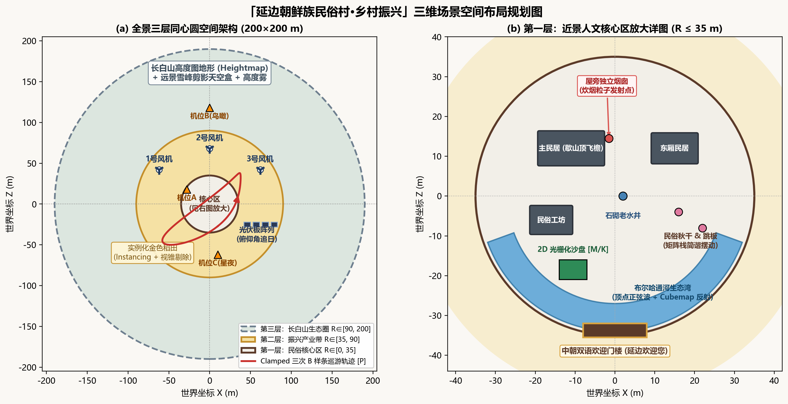
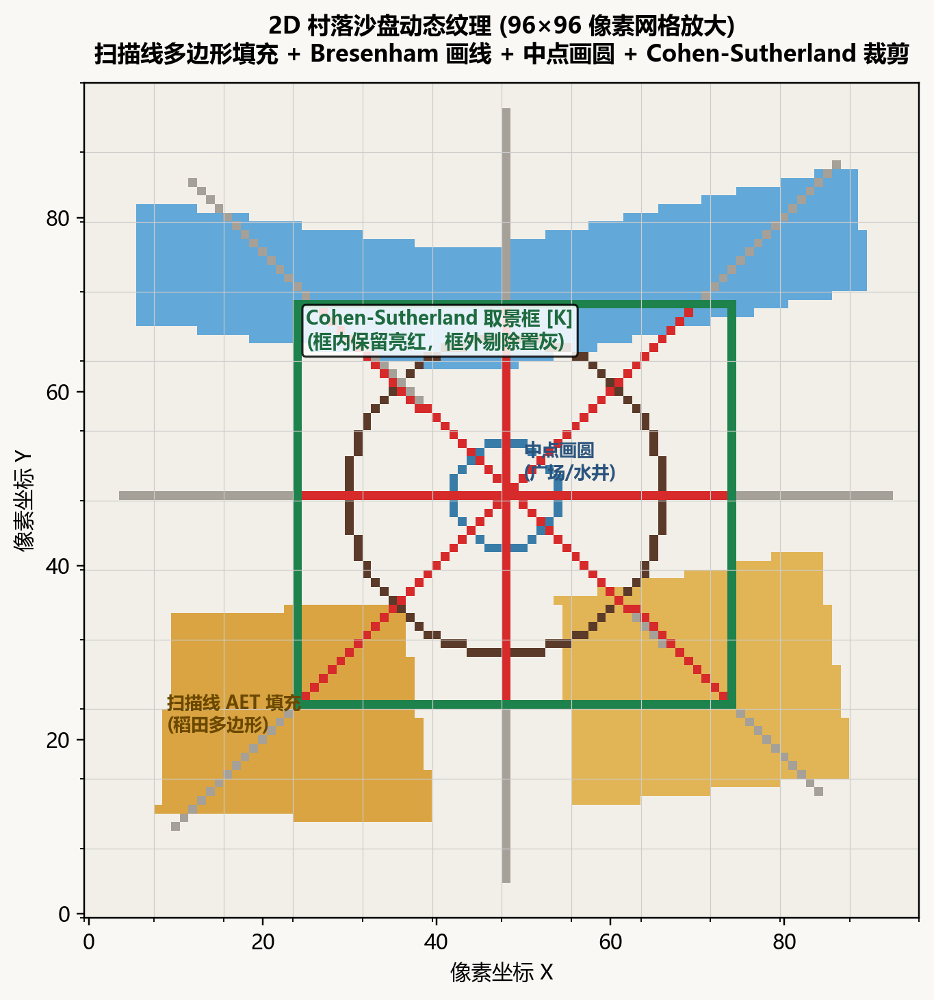
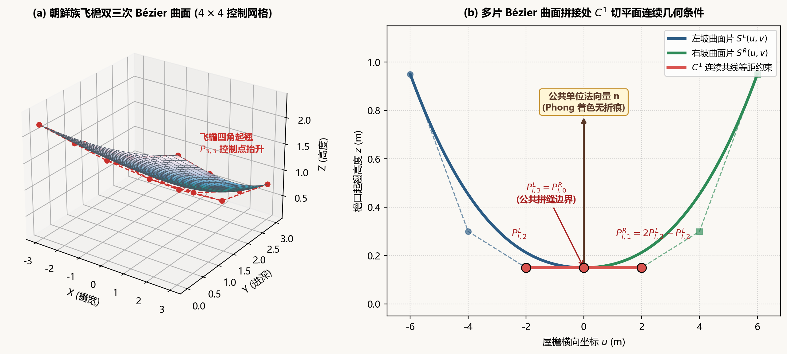
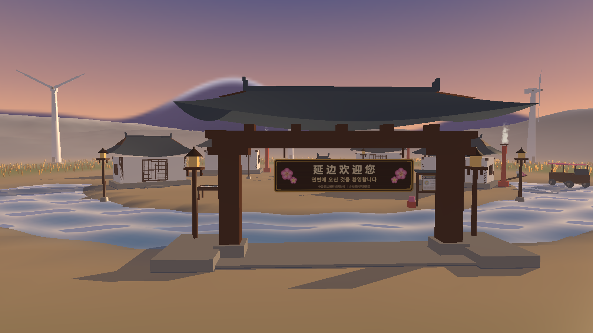
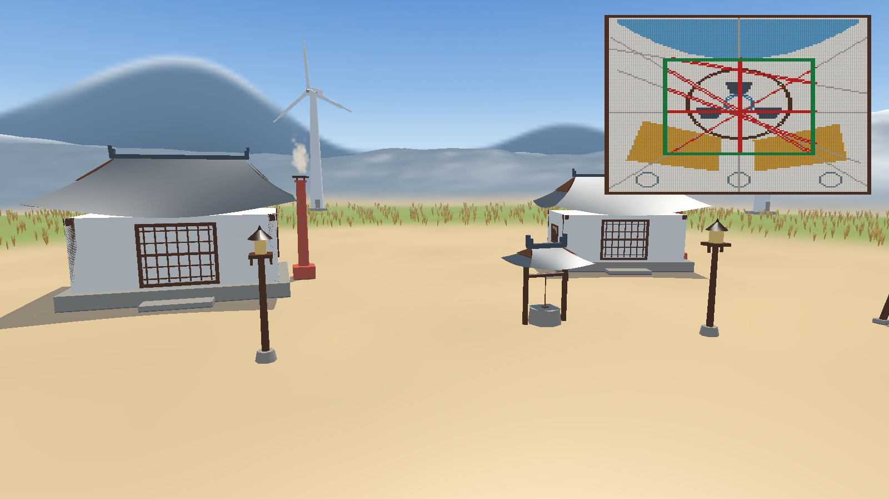
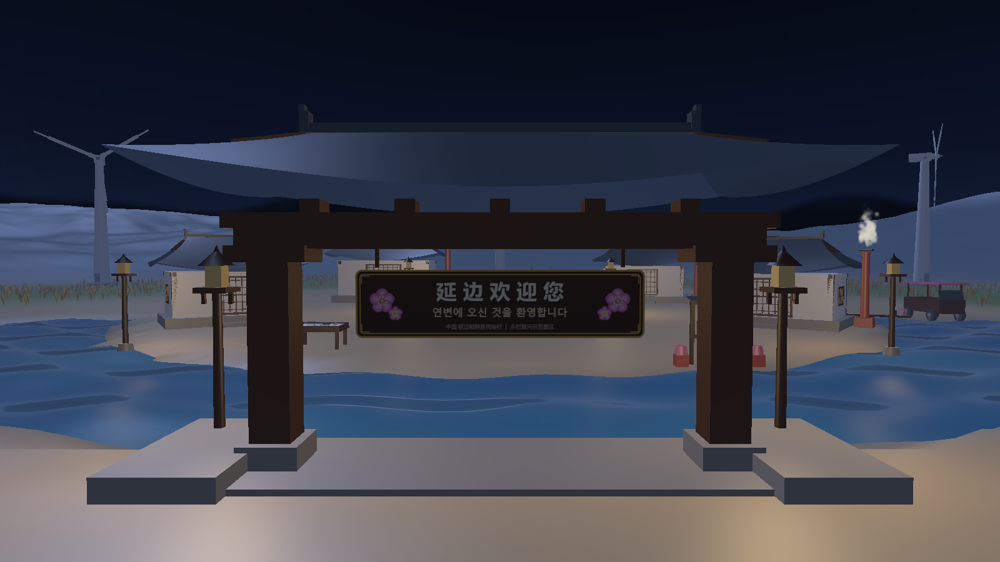
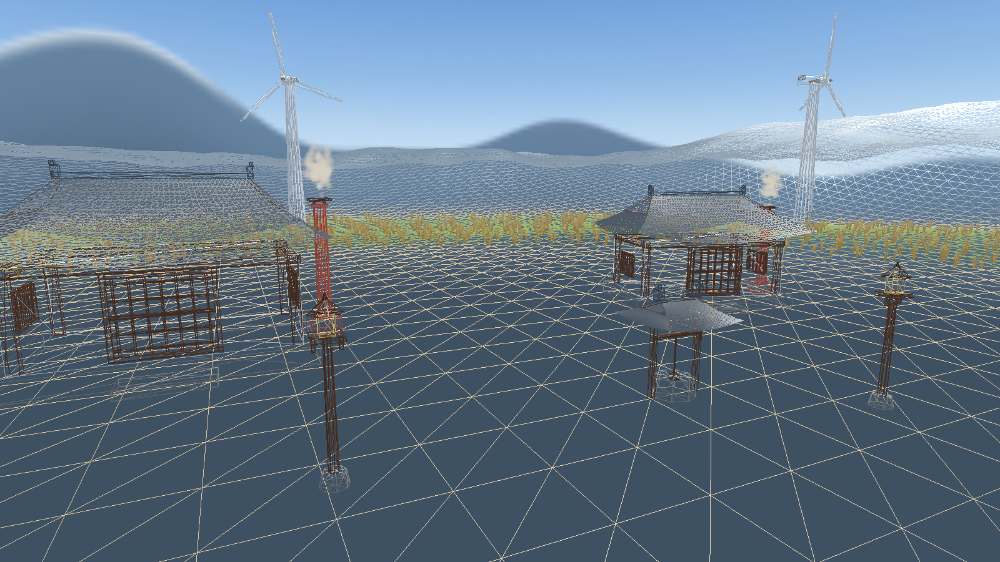
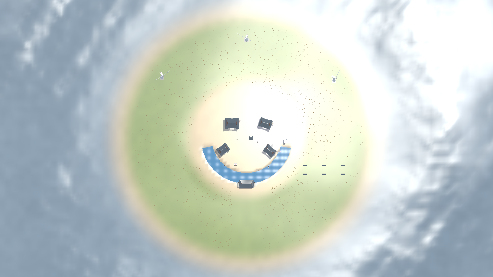

# 《计算机图形学》课程设计报告书

## 延边朝鲜族民俗村·乡村振兴三维数字场景设计与实现

### 摘要

本课程设计以“数字光影里的延边民俗村：金秋晨曦中的振兴画卷”为主题，使用 C++17 与 OpenGL 3.3 Core Profile，构建一个 200×200 m 的三维笛卡尔空间。场景把朝鲜族传统民居、乡村绿色产业和旅游互动导览组织到三层同心圆布局中，并以自定义 Uber-Shader、显式矩阵栈、双三次 Bézier 曲面、B 样条巡游路径、二维光栅化算法和多光源 Blinn-Phong 模型完成可编程渲染。报告重点推导 Bresenham 画线、中点画圆、扫描线填充、Cohen-Sutherland 裁剪、Bézier 曲面 C¹ 拼接、观察投影矩阵、层级建模、光照与平面阴影等课程知识点，说明这些算法如何在可交互的民俗村场景中落地。

**关键词：** OpenGL；Bézier 曲面；B 样条；光栅化；Blinn-Phong；平面阴影；延边民俗村

---

## 第 1 章 绪论与场景设计立意

### 1.1 三大命题与空间组织

项目把“延边朝鲜族民俗特色”“乡村振兴现代产业风貌”和“旅游城市互动导览”统一到以村落中心广场为原点的三维坐标系中，$Y$ 轴向上，场景边界为 $200\times200\text{ m}$。以半径 $R=\sqrt{x^2+z^2}$ 划分空间，可同时控制视觉层次、绘制优先级和算法演示范围。

近景人文核心区为 $R\in[0,35\text{ m}]$。白墙使用 `#F2EFE8`，青灰筒瓦使用 `#4A5560`，建筑采用四角如鹤翼微翘的朝鲜族歇山式传统民居。屋旁设置独立火炕烟囱，烟囱顶作为炊烟粒子发射点；百年老树下布置民俗秋千和跳板，石砌老水井、中文/한글双语迎宾门楼与可近距离观察的布尔哈通河生态湾共同构成人文核心。近景物体采用程序化网格、Bezier 飞檐和纹理牌匾，保证观众能够从漫游视角辨认民族建筑细节。

中景振兴产业带为 $R\in[35,90\text{ m}]$，通过实例化绘制随风起伏的金色稻田，颜色从 `#D9A441` 过渡到 `#E8C26A`；三座旋转风力发电机和追日太阳能光伏板阵列形成传统村落与绿色产业的对照。远景长白山生态圈为 $R\in[90,200\text{ m}]$，使用程序化分形高度场、雪顶主峰剪影和指数高度雾，使远山在有限几何量下仍具有纵深感。

### 1.2 季节、昼夜与视觉规范

默认状态是金秋：金色稻田、晨间炊烟和远山红叶构成主视觉；按 `O` 切换为初冬瑞雪，稻田变为浅褐色茬地，粒子由炊烟变成雪花，屋顶和地面叠加积雪色。金达莱作为延边州花，以门楼和导览牌上的彩绘出现，避免与季节设定冲突。

按 `1/2/3` 切换“晨曦初露、正午晴空、星夜灯火”。状态切换不是瞬时跳变，而是在 1.5 s 内对太阳方向、光色、环境光、雾色和天空盒混合参数做 smoothstep 插值。晨曦太阳仰角约 $15^\circ$、暖橙光 `#FFB070`、开启长投影；正午仰角约 $70^\circ$、白光 `#FFF6E8`、阴影较短；星夜采用深蓝月光 `#4060A0`，关闭日间阴影，打开六盏暖黄点光源 `#FFC870`。

统一风格为 Low-poly Stylized：程序化几何体承担主体，面片轮廓清晰，纹理仅用于瓦片、木格栅、双语牌匾等细节。色彩表如下。

| 用途 | 色值 | 设计作用 |
| :--- | :--- | :--- |
| 民居白墙 | `#F2EFE8` | 暖白，避免纯白过曝 |
| 青灰瓦顶 | `#4A5560` | 强化朝鲜族传统屋顶识别度 |
| 木框门窗 | `#5B3A29` | 勾勒建筑结构 |
| 石基与水井 | `#9A958C` | 与墙体形成中性对比 |
| 金秋稻田 | `#D9A441` → `#E8C26A` | 表现成熟稻穗的高度渐变 |
| 金达莱彩绘 | `#E07AA0` | 少量民族装饰色 |
| 远山 | `#6E7F8F` → 雾色 | 与高度雾自然融合 |
| 风车/光伏 | `#E6E9EC` / `#2B3A55` | 现代冷色产业符号 |

---

## 第 2 章 系统总体架构与可编程渲染管线

### 2.1 工程模块与职责

系统采用 C++17、GLFW 3.4、glad、GLM 1.0.1 和 stb_image，窗口为 1600×900、4× MSAA，并保留 8 位模板缓冲。核心层 `core/` 管理窗口输入、Shader、Mesh、Texture、Camera；数学层 `math/` 提供矩阵、视锥、曲面和曲线路径；场景层 `scene/` 组装民居、风车、地形、稻田与河湾；特效层 `fx/` 管理光照、天空盒、粒子和平面阴影；二维层 `ui/` 负责光栅化沙盘和 HUD。模块之间以网格、矩阵和状态对象通信，避免把建模、渲染状态和输入逻辑混在一起。

| 层次 | 主要文件/模块 | 职责 |
| :--- | :--- | :--- |
| `core/` | `Shader`、`Mesh`、`Texture`、`Camera`、`Input` | OpenGL 资源、相机与按键状态 |
| `math/` | `MathUtil`、`MatrixStack`、`Frustum`、`BezierPatch`、`BSplinePath` | 变换、裁剪、曲面与曲线数学 |
| `scene/` | `KoreanHouse`、`BezierRoof`、`HierarchyObjects`、`Terrain`、`Water`、`RiceField` | 场景几何和层级物体 |
| `fx/` | `LightingState`、`Skybox`、`PlanarShadow`、`ParticleSystem` | 光影、天空、阴影与粒子 |
| `ui/` | `Raster2DBoard`、`Hud` | 二维算法演示和屏幕叠加 |

### 2.2 教材知识点映射

| 教材知识点 | 场景落地 | 演示方式 |
| :--- | :--- | :--- |
| 基本图元光栅化 | 沙盘道路、田埂、水井 | `M` 放大像素网格 |
| 二维裁剪 | 沙盘取景框内道路 | `K` 开关，方向键移动 |
| 三维几何与矩阵栈 | 民居、秋千、风车 | 观察层级旋转 |
| 观察与投影 | 漫游、鸟瞰 | `V` 切换透视/正交 |
| 曲线与曲面 | 飞檐、巡游路线 | `B` 切换细分，`P` 巡游 |
| 消隐与视锥剔除 | 建筑遮挡、稻田地块 | `Z` 深度测试，实例剔除 |
| 光照与明暗 | 三态光影、路灯 | `F` 切换 Flat/Gouraud/Phong |
| 纹理与阴影 | 牌匾、瓦片、河面反射 | 白模/材质/阴影对比 |
| 粒子系统 | 炊烟与瑞雪 | `O` 切换季节 |

### 2.3 Uber-Shader 五阶段单帧管线

Pass 1 计算 $\Delta t$、风车角、秋千摆角、观光车位置、B 样条相机、粒子生命周期和光照插值；沙盘变化时由 CPU 更新 RGBA 数组，再调用 `glTexSubImage2D`。Pass 2 解决关闭深度测试时天空盒覆盖场景的问题：先关闭深度写入绘制天空背景。Pass 3 开启深度测试，按地形、稻田、民居、风车/秋千/观光车、水面的顺序绘制不透明物体。Pass 4 在日间构造平面阴影并用模板缓冲防止叠加变黑，正常天空盒使用 `GL_LEQUAL` 和 `pos.xyww`。Pass 5 开启混合、关闭深度写入，按相机距离由远到近绘制双语牌匾和粒子，最后绘制 HUD。

---

## 第 3 章 核心图形学算法数学推导与代码实现

### 3.1 二维基本图元光栅化与裁剪沙盘

`Raster2DBoard` 在 128×128 RGBA 数组中生成村落规划纹理，同时贴到三维沙盘台面和 HUD。道路、田埂、水井、稻田地块分别对应直线、圆、多边形填充和裁剪算法。

#### 3.1.1 Bresenham 画线

设第一八分象限中 $0\le\Delta y\le\Delta x$，理想直线为 $y=mx+b$，其中 $m=\Delta y/\Delta x$。在当前像素 $(x_k,y_k)$ 向右前进时，只需在候选点 $(x_k+1,y_k)$ 与 $(x_k+1,y_k+1)$ 中选择更接近直线者。将中点代入隐式误差函数并乘以 $2\Delta x$，得到判别量 $p_k$。取初始点 $(x_0,y_0)$，有

$$p_0=2\Delta y-\Delta x.$$

若 $p_k<0$，选择水平步进，误差更新为 $p_{k+1}=p_k+2\Delta y$；若 $p_k\ge0$，选择对角步进，更新为 $p_{k+1}=p_k+2\Delta y-2\Delta x$。合并写为

$$p_{k+1}=p_k+2\Delta y-2\Delta x\,[p_k\ge0].$$

判断只使用整数加减，避免逐像素浮点计算。实际代码把 $dy$ 取负并使用 `sx/sy` 处理八个方向：`err=dx+dy`，令 `e2=2*err`，当 `e2>=dy` 沿 $x$ 走，当 `e2<=dx` 沿 $y$ 走，因此道路无论斜率和方向如何都能得到连续像素链。

#### 3.1.2 中点画圆

圆方程为 $f(x,y)=x^2+y^2-R^2$。从八分圆起点 $(0,R)$ 出发，考察候选像素之间的中点。把常数项和离散增量整理后，初值为

$$d_0=1-R.$$

若 $d<0$，中点在圆内，选择 $(x+1,y)$，有 $d\leftarrow d+2x+3$；否则选择 $(x+1,y-1)$，有 $d\leftarrow d+2(x-y)+5$。每取得一个 $(x,y)$，利用

$$ (\pm x,\pm y),\quad(\pm y,\pm x) $$

的八重对称同时写入八个像素。水井和中心广场因此只需遍历 $x\le y$ 的八分之一，计算量约为整圆的八分之一，同时保持像素边界一致。

#### 3.1.3 ET/AET 扫描线填充

对多边形每条非水平边建立边表 ET，边记录上端扫描线 `ymax`、当前交点 $x$ 和逆斜率 $1/m=\Delta x/\Delta y$。扫描线从 $y_{min}$ 到 $y_{max}-1$，把当前行 ET 中的新边加入活性边表 AET，删除满足 `ymax==y` 的边，按交点横坐标排序，再将交点两两配对并填充区间。

采用左闭右开规则 $[y_{min},y_{max})$，原因是局部极值顶点同时连接两条边：若两条边在同一行都计入，会把一个几何交点错误计数两次，破坏内外奇偶配对。让边在较低端进入、在上端之前退出，恰好使极值点只参与一次。水平边直接跳过，每行填充

$$x\in[\lceil x_L\rceil,\lceil x_R\rceil),$$

并执行 $x\leftarrow x+\Delta x/\Delta y$ 的增量更新。该规则既避免裂缝，也使相邻地块的边界不会因舍入产生重复覆盖。

#### 3.1.4 Cohen-Sutherland 裁剪

矩形取景框用四位区域码表示：`LEFT=1`、`RIGHT=2`、`BOTTOM=4`、`TOP=8`。端点区域码分别为 $c_0,c_1$。若

$$c_0\,|\,c_1=0,$$

两端都在窗口内，直接接受；若

$$c_0\,&\,c_1\ne0,$$

两端位于同一外侧，线段必然不可见，直接拒绝。否则取窗口外端点，按优先级求交。例如与上边界相交时

$$x=x_0+(x_1-x_0)\frac{y_{max}-y_0}{y_1-y_0},\qquad y=y_{max};$$

与右边界相交时

$$y=y_0+(y_1-y_0)\frac{x_{max}-x_0}{x_1-x_0},\qquad x=x_{max}.$$

以新交点替换外端点并重新编码，直到完全接受或拒绝。沙盘先以灰色显示完整道路，再以亮红色覆盖裁剪后的部分，`K` 加方向键移动窗口即可观察位与/位或的快速判别效果。

### 3.2 朝鲜族歇山顶的双三次 Bézier 曲面

三次 Bernstein 基函数为

$$B_{0,3}(t)=(1-t)^3,\quad B_{1,3}(t)=3t(1-t)^2,$$

$$B_{2,3}(t)=3t^2(1-t),\quad B_{3,3}(t)=t^3.$$

其导数为

$$B'_{0,3}=-3(1-t)^2,$$
$$B'_{1,3}=3(1-t)^2-6t(1-t),$$
$$B'_{2,3}=6t(1-t)-3t^2,\quad B'_{3,3}=3t^2.$$

4×4 控制点 $P_{i,j}$ 生成双三次曲面

$$P(u,v)=\sum_{i=0}^{3}\sum_{j=0}^{3}B_{i,3}(u)B_{j,3}(v)P_{i,j},\quad 0\le u,v\le1.$$

对 $u,v$ 求偏导得到

$$P_u=\sum_{i,j}B'_{i,3}(u)B_{j,3}(v)P_{i,j},\qquad
P_v=\sum_{i,j}B_{i,3}(u)B'_{j,3}(v)P_{i,j}.$$

解析单位法向量为

$$\mathbf n=\frac{P_u\times P_v}{\|P_u\times P_v\|}.$$

当叉积长度接近零时使用 $(0,1,0)$ 作为退化点兜底。屋顶前后长坡各拆为左右两片，使中段平缓、两端可以抬升；短坡与长坡在戗脊处保留几何棱线。

关键是左右坡面片拼缝的 $C^1$ 连续。设左片为 $L$、右片为 $R$，沿 $v$ 方向相接，则位置连续要求

$$P^R_{i,0}=P^L_{i,3},\quad i=0,1,2,3.$$

Bezier 边界导数分别与相邻边控制点差成正比：左侧末端导数为 $3(P^L_{i,3}-P^L_{i,2})$，右侧起始导数为 $3(P^R_{i,1}-P^R_{i,0})$。令两者相等，得到

$$P^R_{i,1}=2P^L_{i,3}-P^L_{i,2}.$$

因此拼缝两侧控制点共线且等距，跨片偏导一致，法向量连续变化。代码只手写左片控制点，自动计算右片第 0、1 列，消除 Blinn-Phong 高光在屋脊中线处的折痕。

### 3.3 矩阵栈、观察投影与 B 样条巡游

OpenGL 使用列向量和列主序矩阵，物体点的最终变换写为

$$v_{clip}=P\cdot V\cdot M\cdot v,$$

其中模型矩阵按“先缩放、再旋转、后平移”构造为

$$M=T\cdot R\cdot S.$$

非均匀缩放会改变法线方向，因此法线矩阵不能直接使用 $M$ 的左上角 3×3，而应为

$$N=(M^{-1})^T.$$

手写 LookAt 时令 $\mathbf f=normalize(center-eye)$，$\mathbf s=normalize(\mathbf f\times\mathbf up)$，$\mathbf u=\mathbf s\times\mathbf f$，矩阵前三列由 $\mathbf s,\mathbf u,-\mathbf f$ 构成，平移项为 $(-\mathbf s\cdot eye,-\mathbf u\cdot eye,\mathbf f\cdot eye)$。透视矩阵令 $t=1/\tan(fovy/2)$，关键项为

$$P_{00}=t/aspect,\quad P_{11}=t,\quad P_{22}=\frac{f+n}{n-f},\quad P_{23}=-1,\quad P_{32}=\frac{2fn}{n-f}.$$

风车使用显式矩阵栈：先压入塔架基矩阵，绘制塔架；再乘 $T(0,h,0)R_y(yaw)$ 得到机舱；再乘轮毂平移和 $R_z(rotor)$ 得到轮毂；最后为三片扇叶分别乘以 $R_z(0),R_z(120^\circ),R_z(240^\circ)$。`push/pop` 使子节点变换不会污染兄弟节点。

三次均匀 B 样条可写成

$$\mathbf C(t)=\frac16[ t^3\;t^2\;t\;1]
\begin{bmatrix}-1&3&-3&1\\3&-6&3&0\\-3&0&3&0\\1&4&1&0\end{bmatrix}
\begin{bmatrix}P_i\\P_{i+1}\\P_{i+2}\\P_{i+3}\end{bmatrix}.$$

首尾控制点各重复三次形成 Clamped 曲线，使路线严格经过起点和终点。预采样 1000 个点建立弧长 LUT，通过按弧长反查参数 $t$ 实现匀速导览；切向量 $C'(t)$ 决定相机朝向，避免观光车或相机在控制点附近忽快忽慢。

### 3.4 Blinn-Phong、多种明暗处理与平面阴影

对平行光和点光源统一计算环境、漫反射和高光。对第 $i$ 盏点光源，距离衰减为

$$f_{att,i}=\frac1{k_c+k_l d_i+k_qd_i^2}.$$

设单位法线为 $N$、指向光源方向为 $L_i$、视线方向为 $V$，半程向量为 $H_i=normalize(L_i+V)$，则

$$C= C_{amb}k_a+\sum_i f_{att,i}\left[C_{diff}k_d\max(0,N\cdot L_i)+C_{spec}k_s\max(0,N\cdot H_i)^p\right].$$

平行光只保留不衰减方向项；夜间使用六盏点光源，白天使用太阳方向和日间阴影。

Flat 着色在片元阶段以 `normalize(cross(dFdx(P),dFdy(P)))` 求几何面法线，面片边界明确，适合观察低多边形风格；Gouraud 在顶点计算 Blinn-Phong，再对颜色插值，速度快但飞檐和水面的高光可能在顶点之间消失；Phong 插值法线和世界坐标，在片元逐像素计算，飞檐连续曲面和河湾水波的高光最平滑。片元末尾进行

$$color=pow(color,vec3(1/2.2)),$$

并用 sRGB 纹理格式保证光照在线性空间计算。

地面平面写为 $\mathbf n\cdot\mathbf X+d=0$，平行光齐次方向写为 $\mathbf L=(L_x,L_y,L_z,0)^T$。点 $X$ 沿光线投影到平面上的参数由

$$\mathbf n\cdot(X-\lambda\mathbf L)+d=0$$

得到 $\lambda=(\mathbf n\cdot X+d)/(\mathbf n\cdot\mathbf L)$。整理齐次坐标后得到平面投影阴影矩阵

$$M_{shadow}=(\mathbf n\cdot\mathbf L)I-\mathbf L\mathbf n^T.$$

白天把地面平面略抬到 $y=0.01$，避免阴影与地面发生 Z-fighting；开启 `GL_STENCIL_TEST`，以 `GL_INCR` 让每个像素最多接受一次阴影贡献，再用冷色半透明值 `rgba(0.15,0.18,0.28,0.45)` 混合。这样多个物体投影相交时不会不断叠加变黑，夜间则直接跳过该 Pass。

---

## 第 4 章 交互演示流程与多模式对比分析

建议录屏从机位 A 的晨曦主视觉开始，按 `P` 启动 B 样条自动巡游，经过门楼、民居和河湾后进入产业带，再切换鸟瞰全景。黄金演示按键如下。

| 按键 | 功能 | 观察重点 |
| :--- | :--- | :--- |
| `W/A/S/D` + 鼠标 | 第一人称漫游 | 相机观察变换与空间层次 |
| `P` | B 样条自动巡游 | 曲线、弧长匀速与旅游导览 |
| `G` | 线框/实体 | 网格拓扑和地形三角剖分 |
| `B` | 4×4/10×10/20×20 细分 | 曲面精度与性能 |
| `F` | Flat/Gouraud/Phong | 飞檐与水面高光 |
| `1/2/3` | 晨曦/正午/星夜 | 光色、雾、阴影和点光源 |
| `V` | 透视/正交鸟瞰 | 投影变换差异 |
| `Z` | 开关深度测试 | 穿模与消隐效果 |
| `M` | 放大二维沙盘 | 光栅化像素算法 |
| `K` + 方向键 | 裁剪窗口 | Cohen-Sutherland 实时裁剪 |
| `O` | 金秋/初冬 | 粒子和材质季节切换 |
| `H` | 帮助 HUD | 快捷键总览 |

五组对比实验体现不同算法的视觉后果。线框模式能直接看到屋顶、地形和稻田的网格组织，实体模式则展示材质和遮挡；Bézier 4×4 细分保留明显折面，20×20 细分让飞檐轮廓和高光连续，10×10 是视觉与绘制量之间的平衡；Flat、Gouraud、Phong 分别突出面片边界、顶点插值限制和逐像素连续高光；晨曦、正午、星夜比较的是参数插值而非三张静态图片；关闭 Z-Buffer 后建筑前后关系被破坏，重新开启后深度测试恢复正确遮挡，从而直观证明消隐的必要性。

### 4.2 系统实机 OpenGL 3.3 渲染对比图集

---

## 第 5 章 调试问题排查与课程设计总结

开发中首先遇到矩阵乘法顺序错误：把局部旋转放到平移之后会使风车扇叶绕世界原点旋转，改用 $M=T\cdot R\cdot S$ 并通过矩阵栈逐级传递后恢复正确。第二个问题是阴影与地面共面产生 Z-fighting，采用 $y=0.01$ 的平面偏移和模板缓冲防重叠后解决。第三个问题是 Bézier 左右片控制点只满足位置连续，屋脊出现法线折痕；补充 $P^R_{i,1}=2P^L_{i,3}-P^L_{i,2}$ 的 $C^1$ 约束后高光平滑。第四个问题是关闭深度测试时天空盒覆盖全部场景；将天空盒移到前置 Pass、关闭深度写入，再在正常模式用 `GL_LEQUAL` 绘制，保证两种状态都正确。

本项目把抽象的光栅化、裁剪、曲面、矩阵、光照、纹理和粒子知识放进一个可操作的文化场景中。通过二维沙盘可观察像素级算法，通过飞檐和风车可观察连续曲面与层级变换，通过昼夜和季节开关可比较渲染状态变化，最终形成从数学推导到工程实现、从视觉设计到交互演示的完整课程设计闭环。

---

## 参考资料与工程依据

1. 项目《代码实施计划（Implementation Plan）》：模块职责、算法接口、渲染 Pass 与交互设计。
2. 项目《计算机图形学课程设计总体方案（修订版 v2）》：场景立意、空间布局、视觉规范与教材知识点映射。
3. `src/ui/Raster2DBoard.cpp`：Bresenham、中点圆、扫描线填充和 Cohen-Sutherland 的实现依据。
4. `src/math/BezierPatch.h`、`src/scene/BezierRoof.h`：双三次曲面和飞檐拼接模块。
5. `src/math/MatrixStack.h`、`src/math/BSplinePath.h`：层级建模与自动巡游路径模块。
6. `src/fx/LightingState.h`、`src/fx/PlanarShadow.h`：三态光照与平面阴影模块。

