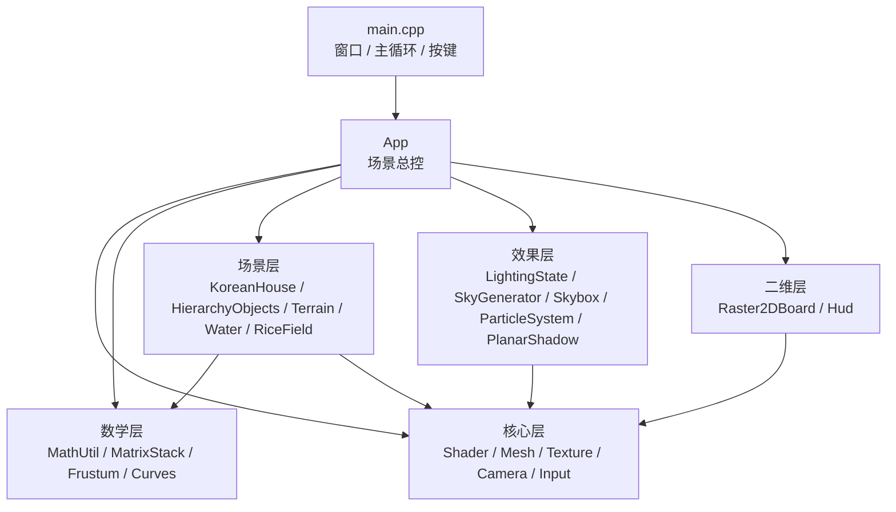
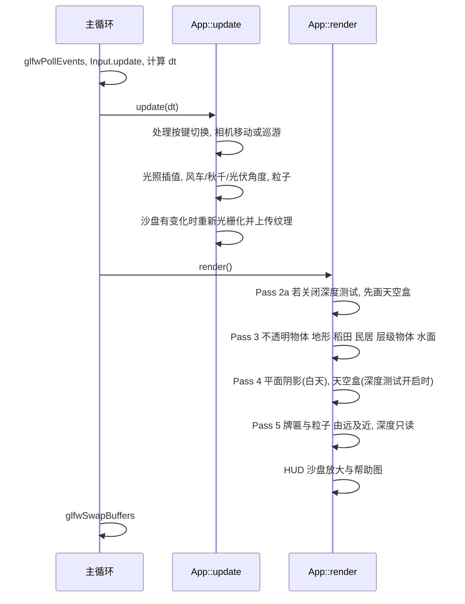

# 代码实施计划（Implementation Plan）
**对应方案**：[code_artifact_v2.md](file:///C:/Users/JoeDre4m/.gemini/antigravity/brain/7e086af1-5aa6-4cb7-99ec-7f1f7e15b904/code_artifact_v2.md)  
**目标**：说明用哪些库、写哪些文件、每个文件做什么、核心算法怎么写、按什么顺序开发、每步如何验收。

---

## 0. 总览



| 项 | 规划 |
| :--- | :--- |
| 语言 / 标准 | C++17 |
| 图形 API | OpenGL 3.3 Core Profile |
| 构建 | CMake ≥ 3.16（Windows：Visual Studio 2022；Linux：GCC） |
| 预计代码量 | C++ 约 4000~5000 行，GLSL 约 400 行 |
| 窗口 | 1600×900，4× MSAA，8 位模板缓冲 |

---

## 1. 第三方依赖

| 库 | 版本 | 用途 | 获取方式 |
| :--- | :--- | :--- | :--- |
| **GLFW** | 3.4 | 窗口、OpenGL 上下文、键鼠输入 | CMake `FetchContent` 自动下载 |
| **glad** | GL 3.3 Core | 加载 OpenGL 函数指针 | 在 glad.dav1d.de 生成后放入 `third_party/glad` |
| **GLM** | 1.0.1 | 向量 / 矩阵基础类型（核心矩阵手写，见 §4.6） | `FetchContent` |
| **stb_image** | 最新 | 加载 PNG 贴图（牌匾、帮助图） | 单头文件，放入 `third_party/stb` |
| **stb_image_write** | 最新 | `F12` 截图存 PNG，用于报告配图 | 同上 |

> [!NOTE]
> 不引入 Assimp 和 ImGui：所有模型都由代码程序化生成，以体现独立建模的工作量；界面只用一张 HUD 贴图。

### CMakeLists.txt 要点
```cmake
cmake_minimum_required(VERSION 3.16)
project(YanbianVillage CXX C)
set(CMAKE_CXX_STANDARD 17)

include(FetchContent)
FetchContent_Declare(glfw GIT_REPOSITORY https://github.com/glfw/glfw.git GIT_TAG 3.4)
FetchContent_Declare(glm  GIT_REPOSITORY https://github.com/g-truc/glm.git  GIT_TAG 1.0.1)
set(GLFW_BUILD_DOCS OFF CACHE BOOL "" FORCE)
FetchContent_MakeAvailable(glfw glm)

add_library(glad STATIC third_party/glad/src/glad.c)
target_include_directories(glad PUBLIC third_party/glad/include)

file(GLOB_RECURSE SRC src/*.cpp)
add_executable(YanbianVillage ${SRC})
target_include_directories(YanbianVillage PRIVATE src third_party/stb)
target_link_libraries(YanbianVillage PRIVATE glfw glm::glm glad)
# 运行时用绝对路径读取 shaders/ 与 assets/，避免工作目录问题
target_compile_definitions(YanbianVillage PRIVATE PROJECT_ROOT="${CMAKE_SOURCE_DIR}")
```

---

## 2. 最终目录结构（在 v2 基础上细化）

```text
YanbianVillage/
├── CMakeLists.txt
├── third_party/
│   ├── glad/                     // include/glad/glad.h, include/KHR, src/glad.c
│   └── stb/                      // stb_image.h, stb_image_write.h
├── src/
│   ├── main.cpp
│   ├── App.h/.cpp                ★ 场景总控：初始化、update、render 五个 Pass
│   ├── core/
│   │   ├── Shader.h/.cpp         // 编译链接 + #include 预处理 + uniform 缓存
│   │   ├── Mesh.h/.cpp           // Vertex 结构、VAO/VBO/EBO、实例化缓冲
│   │   ├── MeshBuilder.h/.cpp    ★ 程序化图元：盒、圆柱、棱台、四边形、网格合并
│   │   ├── Texture.h/.cpp        // 2D 纹理（sRGB）、Cubemap、动态纹理更新
│   │   ├── Camera.h/.cpp         // 欧拉角漫游 + 巡游模式 + 透视/正交切换
│   │   └── Input.h/.cpp          ★ 按键边沿检测（按下瞬间触发一次）
│   ├── math/
│   │   ├── MathUtil.h/.cpp       ★ 手写 LookAt / Perspective / Ortho / sRGB 转换
│   │   ├── MatrixStack.h         ★ 显式矩阵栈 Push / Pop / 变换
│   │   ├── Frustum.h/.cpp        ★ 视锥 6 平面提取与 AABB 测试
│   │   ├── BezierPatch.h/.cpp    ★ 双三次 Bézier 曲面求值与网格化
│   │   └── BSplinePath.h/.cpp    ★ Clamped 三次 B 样条求值、切向、弧长表
│   ├── scene/
│   │   ├── BezierRoof.h/.cpp     // 歇山顶：多片曲面 + C¹ 约束 + 动态细分
│   │   ├── KoreanHouse.h/.cpp    // 民居组装 + 独立烟囱 + 门楼
│   │   ├── HierarchyObjects.h/.cpp // 风车、秋千、跳板、光伏板、观光车
│   │   ├── Terrain.h/.cpp        // 程序化高度场地形（远山 + 河道下凹）
│   │   ├── Water.h/.cpp          // 河湾水面网格
│   │   └── RiceField.h/.cpp      // 稻田实例数据 + 按地块剔除
│   ├── fx/
│   │   ├── LightingState.h/.cpp  // 三态光照预设、平滑插值、季节状态
│   │   ├── SkyGenerator.h/.cpp   ★ CPU 程序化生成三套 Cubemap
│   │   ├── Skybox.h/.cpp         // 天空盒绘制（双 Cubemap 混合）
│   │   ├── PlanarShadow.h/.cpp   // 阴影矩阵 + 模板状态
│   │   └── ParticleSystem.h/.cpp // 炊烟 / 雪花（可选）
│   └── ui/
│       ├── Raster2DBoard.h/.cpp  // 手写光栅化与裁剪，输出动态纹理
│       └── Hud.h/.cpp            // 屏幕叠加层：沙盘放大、帮助图
├── shaders/
│   ├── common/lighting.glsl      ★ Blinn-Phong 公共函数（VS/FS 共用）
│   ├── uber_scene.vert / .frag
│   ├── skybox.vert / .frag
│   ├── particle.vert / .frag
│   └── hud.vert / .frag          ★ 2D 叠加层（像素网格线）
└── assets/
    ├── textures/sign_gate.png    // 双语门楼牌匾（透明 PNG，必需）
    ├── textures/sign_guide.png   // 导览牌（必需）
    └── textures/help.png         // 按键帮助图（必需）
```
★ 表示相对 v2 方案新增或拆分出来的文件。

---

## 3. 各文件职责与关键接口

### 3.1 入口与总控
| 文件 | 做什么 | 关键接口 |
| :--- | :--- | :--- |
| `main.cpp` | 创建 GLFW 窗口（3.3 Core、MSAA 4×），加载 glad，构造 `App`，运行主循环 | `int main()` |
| `App.h/.cpp` | 持有所有子系统；`update(dt)` 推进动画；`render()` 依次执行 5 个 Pass；处理按键状态机 | `init()`, `update(float dt)`, `render()`, `onKey()` |

**App 中维护的全局开关**：
```cpp
struct RenderFlags {
    int  shadeMode   = 2;     // 0 Flat, 1 Gouraud, 2 Phong      [F]
    int  bezierLevel = 1;     // 0:4x4, 1:10x10, 2:20x20        [B]
    bool wireframe   = false; //                                [G]
    bool depthTest   = true;  //                                [Z]
    bool ortho       = false; //                                [V]
    bool touring     = false; // B 样条巡游                      [P]
    bool showBoard   = false; //                                [M]
    bool clipWindow  = false; //                                [K]
    bool showHelp    = false; //                                [H]
    int  season      = 0;     // 0 金秋, 1 初冬                  [O]
};
```

### 3.2 核心层 core/
| 文件 | 做什么 | 关键接口 |
| :--- | :--- | :--- |
| `Shader` | 读取 GLSL 文本，递归替换 `#include "xxx.glsl"`，编译、链接并打印错误日志；缓存 uniform location | `Shader(vs, fs)`, `use()`, `set(name, int/float/vec3/mat4…)`, `reload()` |
| `Mesh` | 统一顶点格式，管理 VAO/VBO/EBO；支持实例化 mat4 属性（location 4~7，divisor=1）；支持重新上传（Bézier 细分切换时用） | `upload(verts, idx)`, `draw()`, `setInstances(vector<mat4>)`, `drawInstanced(n)` |
| `MeshBuilder` | 程序化生成图元并**把变换烘焙进顶点**，合并成一个大网格，减少 draw call | `addBox(M, color)`, `addCylinder(M, r0, r1, h, seg, color)`, `addQuad(...)`, `addGrid(...)`, `append(MeshBuilder&, M)`, `build()` |
| `Texture` | `stb_image` 加载 PNG（`GL_SRGB8_ALPHA8`）；创建 Cubemap；为沙盘提供 `updateSub(pixels)` | `load2D(path)`, `createCube(faces[6], size)`, `createDynamic(w,h)`, `updateSub(data)` |
| `Camera` | 欧拉角（Yaw/Pitch）漫游；巡游模式下位置取 B 样条点、朝向取切向量；生成 V 和 P | `processKeyboard()`, `processMouse()`, `view()`, `proj(aspect)`, `setTour(BSplinePath*)` |
| `Input` | 保存本帧与上帧的按键状态，提供"刚按下"判定，避免一次按键触发多次切换 | `update(window)`, `pressed(key)`, `held(key)` |

**统一顶点格式**：
```cpp
struct Vertex {
    glm::vec3 pos;
    glm::vec3 normal;
    glm::vec2 uv;
    glm::vec3 color;   // 线性空间颜色（调色板经 srgbToLinear 转换）
};
```

### 3.3 数学层 math/（报告重点，全部手写）
| 文件 | 做什么 |
| :--- | :--- |
| `MathUtil` | 手写 `lookAt / perspective / ortho / translate / rotate / scale`，Debug 模式下与 glm 结果断言比对；`srgbToLinear(hex)` |
| `MatrixStack` | `std::vector<glm::mat4>` 实现的栈，`push() / pop() / top() / mul(M)` |
| `Frustum` | 从 `P·V` 提取 6 个平面，测试 AABB 是否可见 |
| `BezierPatch` | 存放 4×4 控制点；`eval(u,v)` 返回位置与法线；`tessellate(n)` 生成网格 |
| `BSplinePath` | 首尾控制点各复制三次（Clamped）；`eval(t)`、`tangent(t)`；用弧长查找表实现匀速 |

### 3.4 场景层 scene/
| 文件 | 做什么 | 细节 |
| :--- | :--- | :--- |
| `BezierRoof` | 生成歇山顶网格 | 前后长坡各拆成**左右 2 片**（中段平缓、两端起翘，单片三次曲面做不出这种形状），拼缝处施加 **C¹ 约束**；左右短坡各 1 片，与长坡在戗脊处 **C⁰ 共边**（戗脊本来就是棱线）；上部山花为平面三角形；正脊用盒体，两端上翘。`rebuild(level)` 按 `B` 键重新细分并上传 |
| `KoreanHouse` | 组装一栋民居并输出合并网格 | 石台基（0.6 m）→ 白墙（2.6 m）→ 深色木柱与门窗格栅 → 屋顶 → **屋侧 1.5 m 处的独立烟囱**（导出烟囱顶坐标给粒子系统）。另提供 `buildGate()` 生成门楼（复用缩小版屋顶） |
| `HierarchyObjects` | 所有需要层级动画的物体，每帧用 `MatrixStack` 计算各部件矩阵并绘制 | 风车：塔架 → 机舱（缓慢偏航）→ 轮毂（旋转）→ 3 片扇叶（各转 120°）；秋千：横梁支点 → 绳 + 座板（$\theta = \theta_0 \sin\omega t$）；跳板：支点 → 板；光伏板：立柱 → 面板（**俯仰角跟随太阳方向**，和光照状态联动）；观光车（可选）：沿 B 样条行驶，车轮为子节点 |
| `Terrain` | 256×256 网格覆盖 400×400 范围 | $h(x,z) = \text{smoothstep}(80,130,r)\cdot 25\cdot \text{fbm}(x,z)$；村落 $r<35$ 保持平地；河道处下凹 0.6；中心差分求法线；顶点色按高度和季节变化 |
| `Water` | 沿 $R\in[26,32]$、角度 200°~300° 的弧形河湾网格（100×10） | 顶点动画和反射都在着色器里做（`u_AnimType=1`，`u_UseEnvMap=true`） |
| `RiceField` | 在 $R\in[40,85]$ 的环带上划分约 60 块地块，每块 100 丛稻株 | 稻株为低多边形交叉棱片；每帧用 Frustum 测试每块地的 AABB，把可见地块的实例矩阵拼接后 `glBufferSubData` 上传（GL 3.3 没有 BaseInstance） |

### 3.5 效果层 fx/
| 文件 | 做什么 |
| :--- | :--- |
| `LightingState` | 三套预设 `{sunDir, sunColor, ambient, fogColor, fogDensity, shadowOn, lampsOn}`；切换时用 1.5 s 的 smoothstep 插值；同时维护天空盒混合参数 `skyA / skyB / blend`、`season`、`snowAmount` |
| `SkyGenerator` | **在 CPU 上逐像素生成三套 Cubemap**：天顶到地平线的渐变、太阳 / 月亮光晕、夜间星点（方向哈希）、长白山远景剪影（方位角 fbm 加主峰高斯包络，峰顶积雪）。不依赖外部图片，风格和低多边形场景统一 |
| `Skybox` | 绘制单位立方体；着色器中按 `blend` 混合两张 Cubemap，实现过渡 |
| `PlanarShadow` | 构建阴影矩阵；设置模板测试与混合状态；夜间不执行 |
| `ParticleSystem` | 粒子结构 `{pos, vel, life, size}`；炊烟从烟囱顶发射、上升并扩散变淡；雪花在相机周围的盒子内循环下落；每帧按距离从远到近排序；用实例化广告牌绘制，圆形软边在着色器里生成，不需要贴图 |

### 3.6 二维层 ui/
| 文件 | 做什么 |
| :--- | :--- |
| `Raster2DBoard` | 在 128×128 的 RGBA 内存数组中**手写**绘制村落规划图：Bresenham 画道路和田埂，中点圆画水井和广场，扫描线填充稻田地块和河道，Cohen-Sutherland 按取景框裁剪道路（框内亮红，框外灰色）。数据变化时调用 `Texture::updateSub`。这张纹理同时贴在 3D 沙盘台面上和 HUD 上 |
| `Hud` | 正交投影绘制屏幕四边形：右上角放大显示沙盘（`GL_NEAREST`，在着色器里画像素网格线）；按 `H` 显示帮助图 |

---

## 4. 核心算法参考实现

### 4.1 Bresenham 画线（全八分象限整数版）
```cpp
void Raster2DBoard::drawLine(int x0, int y0, int x1, int y1, RGBA c) {
    int dx =  std::abs(x1 - x0), sx = x0 < x1 ? 1 : -1;
    int dy = -std::abs(y1 - y0), sy = y0 < y1 ? 1 : -1;
    int err = dx + dy;                       // 误差项 e = dx - |dy|
    while (true) {
        setPixel(x0, y0, c);
        if (x0 == x1 && y0 == y1) break;
        int e2 = 2 * err;
        if (e2 >= dy) { err += dy; x0 += sx; }   // 沿 x 走一步
        if (e2 <= dx) { err += dx; y0 += sy; }   // 沿 y 走一步
    }
}
```
> 报告中用第一八分象限的经典形式推导误差递推 $p_{k+1} = p_k + 2\Delta y - 2\Delta x\,[p_k \ge 0]$，再说明上面的代码是它的对称推广。

### 4.2 中点画圆
```cpp
void Raster2DBoard::drawCircle(int cx, int cy, int r, RGBA c) {
    int x = 0, y = r, d = 1 - r;             // 判别式初值 d0 = 1 - r
    while (x <= y) {
        plot8(cx, cy, x, y, c);              // 八分对称
        if (d < 0) d += 2 * x + 3;
        else     { d += 2 * (x - y) + 5; --y; }
        ++x;
    }
}
```

### 4.3 扫描线多边形填充（边表 ET + 活性边表 AET）
```cpp
struct Edge { int ymax; float x; float invSlope; };

void Raster2DBoard::fillPolygon(const std::vector<glm::ivec2>& P, RGBA c) {
    int ymin = INT_MAX, ymax = INT_MIN;
    for (auto& p : P) { ymin = std::min(ymin, p.y); ymax = std::max(ymax, p.y); }
    std::vector<std::vector<Edge>> ET(ymax - ymin + 1);
    for (size_t i = 0; i < P.size(); ++i) {
        glm::ivec2 a = P[i], b = P[(i + 1) % P.size()];
        if (a.y == b.y) continue;                     // 跳过水平边
        if (a.y > b.y) std::swap(a, b);
        ET[a.y - ymin].push_back({ b.y, (float)a.x, float(b.x - a.x) / (b.y - a.y) });
    }
    std::vector<Edge> AET;
    for (int y = ymin; y < ymax; ++y) {               // 左闭右开，避免顶点重复计数
        AET.insert(AET.end(), ET[y - ymin].begin(), ET[y - ymin].end());
        AET.erase(std::remove_if(AET.begin(), AET.end(),
                  [y](const Edge& e) { return e.ymax == y; }), AET.end());
        std::sort(AET.begin(), AET.end(), [](auto& a, auto& b) { return a.x < b.x; });
        for (size_t i = 0; i + 1 < AET.size(); i += 2)
            for (int x = (int)std::ceil(AET[i].x); x < (int)std::ceil(AET[i + 1].x); ++x)
                setPixel(x, y, c);
        for (auto& e : AET) e.x += e.invSlope;        // 增量更新交点
    }
}
```

### 4.4 Cohen-Sutherland 线段裁剪
```cpp
enum { INSIDE = 0, LEFT = 1, RIGHT = 2, BOTTOM = 4, TOP = 8 };

int outCode(float x, float y, const Rect& w) {
    int code = INSIDE;
    if (x < w.xmin) code |= LEFT;   else if (x > w.xmax) code |= RIGHT;
    if (y < w.ymin) code |= BOTTOM; else if (y > w.ymax) code |= TOP;
    return code;
}

bool clipLine(float& x0, float& y0, float& x1, float& y1, const Rect& w) {
    int c0 = outCode(x0, y0, w), c1 = outCode(x1, y1, w);
    while (true) {
        if (!(c0 | c1)) return true;          // 两端都在窗口内：完全接受
        if (c0 & c1)    return false;         // 两端在同一外侧：完全拒绝
        int out = c0 ? c0 : c1;
        float x, y;
        if      (out & TOP)    { x = x0 + (x1 - x0) * (w.ymax - y0) / (y1 - y0); y = w.ymax; }
        else if (out & BOTTOM) { x = x0 + (x1 - x0) * (w.ymin - y0) / (y1 - y0); y = w.ymin; }
        else if (out & RIGHT)  { y = y0 + (y1 - y0) * (w.xmax - x0) / (x1 - x0); x = w.xmax; }
        else                   { y = y0 + (y1 - y0) * (w.xmin - x0) / (x1 - x0); x = w.xmin; }
        if (out == c0) { x0 = x; y0 = y; c0 = outCode(x0, y0, w); }
        else           { x1 = x; y1 = y; c1 = outCode(x1, y1, w); }
    }
}
```
**演示逻辑**：每条道路先用灰色画完整线段，再把裁剪后的部分用亮红色覆盖画一遍；方向键移动取景框时重新生成纹理。

### 4.5 双三次 Bézier 曲面与 C¹ 拼接
```cpp
static void bernstein(float t, float B[4], float dB[4]) {
    float s = 1 - t;
    B[0] = s*s*s;  B[1] = 3*t*s*s;  B[2] = 3*t*t*s;  B[3] = t*t*t;
    dB[0] = -3*s*s; dB[1] = 3*s*s - 6*t*s; dB[2] = 6*t*s - 3*t*t; dB[3] = 3*t*t;
}

glm::vec3 BezierPatch::eval(float u, float v, glm::vec3& n) const {
    float Bu[4], Bv[4], dBu[4], dBv[4];
    bernstein(u, Bu, dBu); bernstein(v, Bv, dBv);
    glm::vec3 P(0), Pu(0), Pv(0);
    for (int i = 0; i < 4; ++i)
        for (int j = 0; j < 4; ++j) {
            P  += Bu[i]  * Bv[j]  * cp[i][j];
            Pu += dBu[i] * Bv[j]  * cp[i][j];
            Pv += Bu[i]  * dBv[j] * cp[i][j];
        }
    n = glm::cross(Pu, Pv);
    n = glm::length(n) < 1e-6f ? glm::vec3(0, 1, 0) : glm::normalize(n);  // 退化点兜底
    return P;
}
```
**C¹ 约束（BezierRoof 中自动计算，不手填）**：对于左片 L 和右片 R 沿 $v$ 方向的拼缝，
$$P^R_{i,0} = P^L_{i,3}, \qquad P^R_{i,1} = 2P^L_{i,3} - P^L_{i,2} \quad (i = 0..3)$$
即拼缝两侧的控制点共线且等距。代码里只定义左片控制点，右片的第 0、1 列由上式推出，其余列按左右镜像设置。

### 4.6 手写观察与投影矩阵（与 glm 结果比对）
```cpp
glm::mat4 MathUtil::lookAt(glm::vec3 eye, glm::vec3 center, glm::vec3 up) {
    glm::vec3 f = glm::normalize(center - eye);
    glm::vec3 s = glm::normalize(glm::cross(f, up));
    glm::vec3 u = glm::cross(s, f);
    glm::mat4 M(1.0f);                       // GLM 列主序：M[列][行]
    M[0][0] = s.x;  M[1][0] = s.y;  M[2][0] = s.z;
    M[0][1] = u.x;  M[1][1] = u.y;  M[2][1] = u.z;
    M[0][2] = -f.x; M[1][2] = -f.y; M[2][2] = -f.z;
    M[3][0] = -glm::dot(s, eye); M[3][1] = -glm::dot(u, eye); M[3][2] = glm::dot(f, eye);
    return M;
}

glm::mat4 MathUtil::perspective(float fovy, float aspect, float n, float f) {
    float t = 1.0f / std::tan(fovy / 2);
    glm::mat4 M(0.0f);
    M[0][0] = t / aspect;  M[1][1] = t;
    M[2][2] = (f + n) / (n - f);  M[2][3] = -1.0f;
    M[3][2] = 2 * f * n / (n - f);
    return M;
}

glm::mat4 MathUtil::ortho(float l, float r, float b, float t, float n, float f) {
    glm::mat4 M(1.0f);
    M[0][0] = 2 / (r - l);  M[1][1] = 2 / (t - b);  M[2][2] = -2 / (f - n);
    M[3][0] = -(r + l) / (r - l);  M[3][1] = -(t + b) / (t - b);  M[3][2] = -(f + n) / (f - n);
    return M;
}
```

### 4.7 矩阵栈驱动的风车（三级层级）
```cpp
void HierarchyObjects::drawWindmill(Shader& sh, const glm::mat4& base, float yaw, float rotor) {
    MatrixStack st; st.push(base);
    draw(sh, towerMesh, st.top());                                     // 塔架
    st.push(); st.mul(T(0, towerH, 0) * Ry(yaw));
        draw(sh, nacelleMesh, st.top());                               // 机舱
        st.push(); st.mul(T(0, 0, hubOffset) * Rz(rotor));
            draw(sh, hubMesh, st.top());                               // 轮毂
            for (int k = 0; k < 3; ++k) {
                st.push(); st.mul(Rz(glm::radians(120.0f * k)));
                draw(sh, bladeMesh, st.top());                         // 扇叶
                st.pop();
            }
        st.pop();
    st.pop();
}
// draw() 内部：sh.set("u_Model", M); sh.set("u_NormalMat", transpose(inverse(mat3(M))));
```

### 4.8 Clamped 三次均匀 B 样条
```cpp
// ctrl：首尾控制点各已复制 3 次；段数 = ctrl.size() - 3；t ∈ [0, 段数)
glm::vec3 BSplinePath::eval(float t) const {
    int i = std::min((int)t, segCount() - 1);  float s = t - i;
    float b0 = (1-s)*(1-s)*(1-s) / 6;
    float b1 = (3*s*s*s - 6*s*s + 4) / 6;
    float b2 = (-3*s*s*s + 3*s*s + 3*s + 1) / 6;
    float b3 = s*s*s / 6;
    return b0*ctrl[i] + b1*ctrl[i+1] + b2*ctrl[i+2] + b3*ctrl[i+3];
}
glm::vec3 BSplinePath::tangent(float t) const {
    int i = std::min((int)t, segCount() - 1);  float s = t - i;
    float d0 = -(1-s)*(1-s) / 2,      d1 = (3*s*s - 4*s) / 2;
    float d2 = (-3*s*s + 2*s + 1) / 2, d3 = s*s / 2;
    return glm::normalize(d0*ctrl[i] + d1*ctrl[i+1] + d2*ctrl[i+2] + d3*ctrl[i+3]);
}
```
**匀速巡游**：初始化时采样 1000 个点，累加弦长建立 `s → t` 查找表；每帧按 `s += speed·dt` 反查 t。巡游路线约 12 个控制点：村口 → 门楼 → 民居群 → 河湾 → 稻田 → 风车 → 升高俯瞰 → 回到村口。

### 4.9 平面投影阴影矩阵
```cpp
// plane = (a,b,c,d) 满足 ax+by+cz+d=0；L = 指向光源的方向，w=0 表示平行光
glm::mat4 PlanarShadow::matrix(glm::vec4 plane, glm::vec4 L) {
    float d = glm::dot(plane, L);
    glm::mat4 M;
    for (int c = 0; c < 4; ++c)
        for (int r = 0; r < 4; ++r)
            M[c][r] = (r == c ? d : 0.0f) - L[r] * plane[c];
    return M;
}
// 使用：plane = (0, 1, 0, -0.01)；model' = matrix(plane, vec4(sunDir, 0)) * model
```
**模板状态**（避免多个物体的阴影重叠后颜色加深）：
```cpp
glClear(GL_STENCIL_BUFFER_BIT);
glEnable(GL_STENCIL_TEST);
glStencilFunc(GL_EQUAL, 0, 0xFF);
glStencilOp(GL_KEEP, GL_KEEP, GL_INCR);   // 每个像素只画一次阴影
glEnable(GL_BLEND); glBlendFunc(GL_SRC_ALPHA, GL_ONE_MINUS_SRC_ALPHA);
glDepthMask(GL_FALSE);
```

### 4.10 视锥体平面提取与 AABB 测试
```cpp
void Frustum::extract(const glm::mat4& m) {           // m = P * V
    auto row = [&](int i) { return glm::vec4(m[0][i], m[1][i], m[2][i], m[3][i]); };
    glm::vec4 r0 = row(0), r1 = row(1), r2 = row(2), r3 = row(3);
    pl[0] = r3 + r0; pl[1] = r3 - r0;                  // 左、右
    pl[2] = r3 + r1; pl[3] = r3 - r1;                  // 下、上
    pl[4] = r3 + r2; pl[5] = r3 - r2;                  // 近、远
    for (auto& p : pl) p /= glm::length(glm::vec3(p));
}
bool Frustum::visible(const glm::vec3& mn, const glm::vec3& mx) const {
    for (auto& p : pl) {
        glm::vec3 v(p.x > 0 ? mx.x : mn.x, p.y > 0 ? mx.y : mn.y, p.z > 0 ? mx.z : mn.z);
        if (glm::dot(glm::vec3(p), v) + p.w < 0) return false;   // 最靠前的顶点也在外侧
    }
    return true;
}
```

### 4.11 CPU 生成 Cubemap 的方向映射
| 面 | 方向向量（$s_c, t_c \in [-1,1]$，由像素坐标得到） |
| :--- | :--- |
| `+X` | $(1,\ -t_c,\ -s_c)$ |
| `-X` | $(-1,\ -t_c,\ s_c)$ |
| `+Y` | $(s_c,\ 1,\ t_c)$ |
| `-Y` | $(s_c,\ -1,\ -t_c)$ |
| `+Z` | $(s_c,\ -t_c,\ 1)$ |
| `-Z` | $(-s_c,\ -t_c,\ -1)$ |

每个像素：`dir = normalize(...)` → 仰角 `asin(dir.y)` 决定渐变 → `dot(dir, sunDir)` 决定光晕 → 方位角 `atan2(dir.z, dir.x)` 查询山脉高度，仰角低于该高度时画山体（越远的山层越接近雾色）。每面 512×512，三套共 18 张，启动时生成约 0.3 秒。

---

## 5. 着色器设计

### 5.1 `common/lighting.glsl`（VS 和 FS 都 include）
```glsl
struct PointLight { vec3 pos; vec3 color; float kc, kl, kq; };
uniform vec3  u_SunDir;   uniform vec3 u_SunColor;  uniform vec3 u_Ambient;
uniform PointLight u_PointLights[8];  uniform int u_NumPointLights;
uniform vec3  u_CamPos;   uniform float u_Shininess;

void blinnPhong(vec3 N, vec3 P, out vec3 diffuse, out vec3 specular) {
    vec3 V = normalize(u_CamPos - P);
    diffuse  = u_Ambient + u_SunColor * max(dot(N, u_SunDir), 0.0);
    specular = u_SunColor * pow(max(dot(N, normalize(u_SunDir + V)), 0.0), u_Shininess) * 0.3;
    for (int i = 0; i < u_NumPointLights; ++i) {
        vec3 Lv = u_PointLights[i].pos - P;  float d = length(Lv);  vec3 L = Lv / d;
        float att = 1.0 / (u_PointLights[i].kc + u_PointLights[i].kl * d + u_PointLights[i].kq * d * d);
        diffuse  += u_PointLights[i].color * max(dot(N, L), 0.0) * att;
        specular += u_PointLights[i].color * pow(max(dot(N, normalize(L + V)), 0.0), u_Shininess) * att * 0.5;
    }
}
```

### 5.2 `uber_scene.vert` 职责
1. 选择模型矩阵：`u_Instanced ? a_InstanceModel : u_Model`。
2. `u_AnimType == 1`（水面）：$y \mathrel{+}= 0.15\sin(0.8x + 1.5t) + 0.1\sin(1.3z + 1.1t)$，用解析偏导重算法线 $n = \text{normalize}(-\partial h/\partial x,\ 1,\ -\partial h/\partial z)$。
3. `u_AnimType == 2`（稻浪）：按顶点高度加权，在世界空间做 x/z 方向的正弦摆动。
4. `gl_Position = u_Proj * u_View * worldPos`（即 P·V·M）。
5. `u_ShadeMode == 1`（Gouraud）：在这里调用 `blinnPhong()`，输出 `v_GDiffuse`、`v_GSpec`。

### 5.3 `uber_scene.frag` 主体结构
```glsl
void main() {
    if (u_IsShadowPass) {                                    // 阴影 Pass
        if (length(v_WorldPos.xz) > 35.0) discard;           // 只投在村落平地上
        FragColor = u_ShadowColor; return;                   // 冷色半透明
    }
    vec3 base = v_Color;
    float alpha = 1.0;
    if (u_UseTexture) { vec4 t = texture(u_Albedo, v_UV); base *= t.rgb; alpha = t.a; }

    vec3 N = normalize(v_Normal), diff, spec;
    if (u_ShadeMode == 0) {                                  // Flat：屏幕空间导数求面法线
        N = normalize(cross(dFdx(v_WorldPos), dFdy(v_WorldPos)));
        blinnPhong(N, v_WorldPos, diff, spec);
    } else if (u_ShadeMode == 1) {                           // Gouraud：用顶点插值结果
        diff = v_GDiffuse; spec = v_GSpec;
    } else {                                                 // Phong：逐片元计算
        blinnPhong(N, v_WorldPos, diff, spec);
    }

    base = mix(base, vec3(0.92), u_SnowAmount * smoothstep(0.6, 0.9, N.y));  // 冬季积雪
    vec3 color = base * diff + spec;

    if (u_UseEnvMap) {                                       // 水面环境反射 + Fresnel
        vec3 V = normalize(u_CamPos - v_WorldPos);
        vec3 R = reflect(-V, N);
        vec3 env = mix(texture(u_SkyA, R).rgb, texture(u_SkyB, R).rgb, u_SkyBlend);
        float F = 0.02 + 0.98 * pow(1.0 - max(dot(N, V), 0.0), 5.0);
        color = mix(color, env, F);
    }

    float dist = length(u_CamPos - v_WorldPos);              // 距离 + 高度雾
    float fog = 1.0 - exp(-pow(u_FogDensity * dist, 2.0));
    fog *= exp(-max(v_WorldPos.y, 0.0) * u_FogHeightFalloff);
    color = mix(color, u_FogColor, clamp(fog, 0.0, 1.0));

    FragColor = vec4(pow(color, vec3(1.0 / 2.2)), alpha);    // 伽马校正
}
```

### 5.4 其他着色器
| 着色器 | 要点 |
| :--- | :--- |
| `skybox` | `gl_Position = (P * mat4(mat3(V)) * pos).xyww`；片元中按 `u_SkyBlend` 混合两张 Cubemap，并做伽马校正 |
| `particle` | 实例属性 `(pos, size, alpha)`；用相机的 right / up 向量展开广告牌；片元按到中心的距离做圆形软边，`alpha *= 1 - smoothstep(0.3, 0.5, r)` |
| `hud` | 正交投影的屏幕四边形；`u_ShowGrid` 为真时用 `fract(uv * texSize)` 在像素边界画细网格线，直观展示光栅化结果 |

---

## 6. 主循环与每帧渲染顺序



**关键 OpenGL 状态切换**：
```cpp
// Pass 3 不透明物体
flags.depthTest ? glEnable(GL_DEPTH_TEST) : glDisable(GL_DEPTH_TEST);
glPolygonMode(GL_FRONT_AND_BACK, flags.wireframe ? GL_LINE : GL_FILL);
// Pass 4 天空盒
glDepthFunc(GL_LEQUAL); skybox.draw(); glDepthFunc(GL_LESS);
// Pass 5 半透明物体
glEnable(GL_BLEND); glDepthMask(GL_FALSE); /* 排序后绘制 */ glDepthMask(GL_TRUE);
```

---

## 7. 美术资源清单

| 资源 | 来源 | 是否必需 |
| :--- | :--- | :--- |
| 三套天空盒 | `SkyGenerator` 程序化生成 | 不需要外部文件 |
| 瓦片 / 木纹纹理 | `Texture` 在 CPU 上程序化生成（条纹 + 噪声），或使用 ambientCG 的 CC0 素材 | 可选 |
| 门楼牌匾 `sign_gate.png` | 用 PS / Canva 制作 1024×256 透明 PNG：中文"延边欢迎您"，朝鲜文「연변에 오신 것을 환영합니다」，两侧金达莱彩绘 | **必需** |
| 导览牌 `sign_guide.png` | 同上，内容为景点简介 | **必需** |
| 帮助图 `help.png` | 按键说明表，半透明底 | **必需** |
| 字体 | 制作 PNG 时使用思源黑体 / 思源宋体（含韩文，免费可商用） | — |

---

## 8. 开发顺序与验收清单

| 阶段 | 要写的文件 | 验收标准（全部满足才进入下一阶段） |
| :--- | :--- | :--- |
| **M1 基础框架**（约 2 天） | CMake、`main`、`App`、`Shader`、`Mesh`、`MeshBuilder`、`Input`、`Camera`、`MathUtil` | ① 窗口能打开，WASD + 鼠标漫游正常；② 地面网格和若干彩色盒子正确显示；③ 手写 lookAt / perspective 与 glm 断言一致；④ `G` 线框、`V` 正交可用 |
| **M2 几何算法**（约 3~4 天） | `BezierPatch`、`BezierRoof`、`KoreanHouse`、`MatrixStack`、`HierarchyObjects`、`Raster2DBoard`、`Hud`、`Texture` | ① 线框模式下歇山顶形状正确，`B` 切换细分时 Phong 着色看不到拼缝；② 风车三级联动、秋千摆动正常；③ `M` 显示沙盘，能看到线、圆、填充；④ `K` 取景框裁剪结果正确，拖动时实时更新 |
| **M3 光影材质**（约 3 天） | `uber_scene` 全套、`lighting.glsl`、`LightingState`、`SkyGenerator`、`Skybox`、`PlanarShadow` | ① `F` 三种着色差异明显；② `1/2/3` 平滑过渡，夜间天空盒正确、点光源亮起、无阴影；③ 阴影无 Z-fighting、重叠不加深；④ 关闭 `Z` 后天空盒不遮挡场景；⑤ 画面无发灰（伽马校正生效） |
| **M4 动态与导览**（约 2 天） | `BSplinePath`、`Water`、`Camera` 巡游模式、`Terrain`（简化版） | ① `P` 巡游平滑匀速，起止点准确；② 水面有波动、能反射天空、掠射角反射更强；③ 镜头朝向沿路线切线方向 |
| **M5 可选增强**（视时间而定） | `ParticleSystem`、`RiceField` + `Frustum`、完整 `Terrain`、观光车 | ① 炊烟从独立烟囱升起；② `O` 切换季节后稻田、地表、粒子同步变化；③ 转动视角时被剔除的地块数会变化（可在控制台输出） |
| **M6 交付**（约 2 天） | 截图功能 `F12`、README | ① 按 v2 的三个主机位截图；② 录制 2~3 分钟视频；③ 报告配图齐全（5 组对比图） |

> [!TIP]
> **开发调试辅助**（不计入演示）：`R` 热重载着色器；`F12` 截图存 PNG；控制台每秒打印 FPS 和可见地块数。这样调色和改光照时不用重新编译。

---

## 9. 风险与应对

| 风险 | 应对 |
| :--- | :--- |
| 歇山顶控制点难调 | 先在线框模式下只调一片曲面；把控制点做成参数化函数（长、宽、起翘高度），不手填坐标 |
| Bézier 退化点（角点）法线异常 | `eval` 中已兜底；必要时对相邻采样点的法线取平均 |
| 平面阴影与地面 Z-fighting | 平面取 `y = 0.01`，并加 `glPolygonOffset(-1, -1)` |
| 非均匀缩放后法线错误 | 统一使用 `transpose(inverse(mat3(M)))`；`MeshBuilder` 烘焙变换时也同样处理法线 |
| 实例化稻田帧率下降 | 先降低每块地的稻株数；剔除放到 M5，不影响核心功能 |
| 中文 / 韩文显示 | 不在 OpenGL 中渲染文字，全部预先做成 PNG 贴图 |
